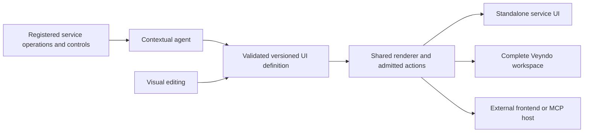

# Agentic interfaces across independent components

**Status, 6 November 2026:** the released SDK now supplies a shared versioned
layout registry and current-service read composition. The existing native workspace
renderer consumes that same layout registry after native rights/PII admission.
The complete cross-service renderer and protocol adapter matrix remain in progress. The [component plan](commerce-components.md#cross-component-agentic-ui)
tracks acceptance. Checkout is explicitly an independent service and UI owner.

A developer should be able to use one Veyndo component with its own interface,
embed a focused view in another product, or assemble the complete Veyndo workspace.
An agent should use the same operations and UI definitions as the person editing
that workspace. Adding a service must not require rewriting navigation, identity,
forms or a second agent implementation.

## Observed foundations and gaps

| Existing owner | Observed capability | Required extension |
| --- | --- | --- |
| `src/capabilities/registry.rs` and `contract.rs` | One native dispatch/input/discovery contract, current admission and conservative agent reads | Flow draft validation publishes a typed result; other native outputs and precise external/financial effects still need per-operation contracts |
| Apps model `surfaces.rs`, `view_types.rs`, `ui_ast.rs` | Strict localized placements, native controls, context/data/action bindings and bounded behavior | Reusable service operation references, shared picker/navigation/results and component compatibility negotiation |
| `extensions/sdk/browser.js` | Host context/locales, declared actions, resize and nonce-bound results | A documented cross-component host contract for opening resources, selection dialogs, results, cancellation, return and unsaved state |
| Current native admission/preview/release owners | Tenant and actor checks, private preview, reviewed immutable definitions | Same connected path for independent service UI packages and generated workspace proposals |
| Operation/model contracts and SDK generators | Existing shared definitions and transport contracts | Required output DTOs and semantic UI annotations generated consistently, with coverage for every service |

These are specific source observations, not an assertion that every module has
completed a security audit. A UI hint never grants access; current server admission
and domain invariants remain authoritative.

## Typed results for native tools

The Core operation registry declares the successful result of
`automation.validate_flow`. MCP tool discovery publishes the schema and Core
checks the result before returning it. The result identifies the draft
revision and confirms the check did not save the Flow. An agent can present
that result in the current draft and offer a separate save action.

The compiled registry produces TypeScript input and result types, OpenAPI
schemas keyed by tool name, and an additive WIT interface for typed results.
The existing WIT interface still returns JSON strings. Operations without a
declared result continue to use their existing response.

Use the [SDK 0.4.1 prerelease](https://github.com/veyndo/sdk/releases/tag/v0.4.1)
to consume this result from TypeScript. The installed release package was
tested with native MCP discovery, current merchant access and PostgreSQL.

## Three delivery modes from one UI owner

Each service repository owns its Rust service and versioned UI package. Its UI
package exports focused views and a minimal standalone application. Veyndo imports
those same views; it must not maintain a second Payments, Reports or Checkout UI.

| Mode | Example | Composition |
| --- | --- | --- |
| Standalone | Payment review console or checkout in an external storefront | Minimal common shell, service client and admitted identity adapter |
| Embedded | Payment status card in order detail; customer picker in a checkout | Focused UI export with typed host ports; React adapter and Web Component wrapper |
| Agent host | Interactive comparison or review inside a supported assistant | The same admitted operations/UI definition through an MCP Apps adapter |

Trusted first-party packages are reviewed and pinned in the product build, sharing
design tokens and the common renderer. Native declarative definitions use registered
controls. Arbitrary external app code remains in the existing isolated iframe path
with explicit CSP, frame/source/origin policy and scoped message grants. Loading
unreviewed remote JavaScript into the privileged administration is not the default.

## One definition and a small UI host contract

Extend the existing operation/App Manifest definitions instead of creating another
operation registry or permissions list. A component descriptor references:

- Versioned operation identity and input/output DTOs.
- Resource meaning: order, product, customer, checkout, payment or document.
- Registered UI views/controls and permitted data/action bindings.
- Precisely declared read/proposal/write/external/financial effect semantics,
  preview/review support, replay/idempotency and uncertain-outcome behavior.
- Required/optional component capabilities and compatible API/UI versions.

These are descriptions checked against actual operations. The model cannot declare
itself authorized, idempotent or safe to retry. Existing published definitions and
fingerprints require backward-compatible defaults or explicit version migrations.

The host supplies API transport, theme, languages, currency formatting, current
shop/channel/environment and selected resource context. Context identifies what
is being edited; it is not proof of authority. Current permissions and data are
resolved server-side. Browser packages receive no privileged service credentials.
Independent deployments use their own identity adapter and narrowly scoped,
audience-bound access through the service's actual admission path.

A view asks the host to `openResource`, `pickResource`, show a review, return a
result or subscribe to changed context. It must not import another service's
router, global store or private components. For example, Payments requests an
order view through a typed resource reference; in Veyndo the host opens order
detail, while an external host can provide its own order adapter. Missing optional
capabilities produce an explicit available alternative. Required dependencies are
checked before activation. Unsaved work, navigation return and cancellation have
one shared lifecycle.

Cross-service business work belongs to the existing durable operation/Flow owners.
A sequence of browser events is not a substitute for transaction or saga recovery.

## Agent-generated workspaces

The agent receives the current context, admitted operation catalogue, compatible
controls, allowed data projections and current work/run state. It produces a
validated definition using known controls, operation references and resource
bindings. It does not produce unrestricted privileged JavaScript or invent data.

For example, “Explain this customer's delivery problems and prepare the next
steps” can produce an order grid, shipment timeline, relevant records and a
reviewable proposed action. The person can change filters, edit the layout and
save that exact definition as a personal workspace. A reviewed reusable package
can later make the same workflow available to other users. Read-only workspace
layout and live business changes retain their different authority/release owners.

Manual editing, AI changes and coding-agent proposals use the same revisioned
model. Streaming updates may progressively add validated blocks, while stable
navigation and existing user edits remain intact. Agent runs expose progress,
missing input, cancellation, resumption, budgets, provenance and actual proposals.
Each service can use the shared agent runtime through its own tools and identity
adapter; it must not require the complete Veyndo Core or copy its own planner.

Public storefront and checkout controls keep a deterministic usable path without
an available model. Agent help can configure, explain, prefill and propose; it
cannot manufacture a purchase approval or change trusted prices/payment states.

## Protocol adapters

- [OpenUI](https://github.com/thesysdev/openui) can render generated definitions
  using a supplied component library. Map it to the registered Veyndo catalogue;
  its output remains untrusted until the shared definition/binding checks pass.
- [A2UI](https://a2ui.org/introduction/what-is-a2ui/) describes declarative,
  updateable agent-generated interfaces. Add a version-negotiated adapter to the
  same definition, rather than a second set of commerce actions.
- [MCP Apps](https://apps.extensions.modelcontextprotocol.io/api/documents/Overview.html)
  standardizes interactive UI resources in supporting hosts using isolated frames
  and host communication. Provide progressive fallback to structured/text tool
  results when the host has no UI support. MCP UI transport never replaces current
  domain authentication and authorization.

Adapters must declare supported subsets and reject unsupported bindings or effects
explicitly. Do not label three independently evolving UI models as one system.

## Shared SDK composition

SDK 0.3.0 introduces `@veyndo/sdk/composition`, independently usable in Node and
browser hosts without React, a database or the Core process. Trusted host code
registers each separately authenticated service and its actual view bindings.
Discovery intersects those bindings with currently exposed read tools. Agents
receive only the available view catalogue and propose a bounded versioned layout;
they cannot introduce endpoints, code, operations or permissions.

A context change aborts reads and discards late results. Changing shop, actor,
environment or channel requires new clients and a new composition. A failed service
leaves healthy independent views available, with explicit unavailable state.
No business writes execute during automatic view loading; existing review controls
retain their operation owners. The native Products/Orders/Customers OpenUI
composition now uses the same layout registry, preserving its current criteria,
domain, PII and intake admission.

[SDK contract and runnable two-service example](https://github.com/veyndo/sdk/blob/main/docs/composition.md),
[implementation](https://github.com/veyndo/sdk/pull/3),
[local/native acceptance](evidence/service-workspace-composition-2026-11-06.md).
This delivers the shared host/layout connection, not all component UI exports,
new model runs or completed OpenUI/A2UI/MCP Apps adapters.

## Orders, shipments and shipping policy

In Studio, ask for open orders and the shipping policy. Open the proposed
working view to see the normal Orders grid and the shipping policy passages
from the current shop. Select a row to reach the original order editor and
its deliveries. The policy panel can also be added or removed from the view.
It requires `knowledge.read`. Orders retain their own order and personal data
permissions. The policy lookup sends a fixed query in the current language,
excludes app evidence, and never sends an order ID or calls an AI model.
Retry a failed policy read while keeping the order view open.

For a separate application, [the Node example](examples/order-shipping-workspace.mjs)
uses `@veyndo/sdk/composition` to discover and read the existing Commerce
order and the independent Knowledge document search in parallel. Supply
`COMMERCE_URL`, `COMMERCE_ACCESS_TOKEN`, `KNOWLEDGE_URL`,
`KNOWLEDGE_ACCESS_TOKEN`, `WORKSPACE_SHOP` and `WORKSPACE_ORDER_ID` on
the server, then run the example with Node 22 and SDK 0.3.0. Open the
loopback address printed by the example. Use a disposable order and scoped
test credentials. The example projects shipment states and source passages
only, and shows each service failure independently. Shipping booking and
tracking updates remain with their existing owners.

The native storefront assistant also offers a side-by-side comparison of
shortlisted products present in the current catalog response. A comparison
suggestion opens it directly. It shows the
same contextual prices and stock as the product cards. Each product opens
the native detail page for variant selection, configuration and the explicit
add-to-cart action. Comparison adds no model call and issues no cart writes.

## Delivered standalone operation example

The [App Runtime service](app-runtime-service.md) now demonstrates independent
HTTP/OpenAPI/MCP schemas with the existing SDK and current external identity.
An agent discovers the same typed input/output contract as the HTTP consumer,
then invokes bounded evaluation with supplied examples. It receives a fingerprinted
simulation result with no applied effect. This supplies one actual operation host;
the common generated UI/renderer and cross-service navigation remain the open
work described here. [Runtime service acceptance](evidence/app-runtime-service-component-2026-11-06.md).

## Reuse across Studio, storefront and external hosts

Studio and the storefront assistant share a Markdown renderer for explanatory
text. Tables, lists and emphasis render as React elements. Model-supplied links
and images display as text and raw HTML stays inert. The model can suggest
products, but prices, stock, product links and purchase controls come from the
native catalogue and Checkout. The product comparison is an example of that
separation.

Use the same split when extending a surface. A product page can show an
explanation next to compatible products and actual availability. An order
workspace can pair a delivery explanation with tracking and payment status.
Reports can show a short interpretation alongside the actual filtered grid
or chart. In each case, register the structured component and its read
operation once. Studio, a storefront or an external SDK host can then compose
the view from those registered components. The model supplies the explanation
and suggests a layout. When a user approves a change, the existing operation
checks it.

For partner storefronts, start with the
[one-page PayPal checkout](checkout.md#add-a-one-page-paypal-checkout-to-your-frontend).
The same purchase can be linked from a generated comparison or a conventional
product page.

## Coverage required from every component

| Component | Useful UI exports and agent compositions |
| --- | --- |
| Commerce | Product/customer/order pickers, resource detail, explicit command review |
| Checkout | Cart, address/delivery/payment selection, quote and completion; embedded purchase and return |
| Policies | Explainable rule/price comparison and bounded playground; no mandatory chat service for a pure library |
| Knowledge | Source upload, graph/evidence, retrieval/source withdrawal review |
| Catalog AI | CSV/URL intake, mapping, content/media proposal diff and batch progress |
| Agents | Contextual task entry, run/proposal history, review, cancellation and budgets |
| Simulator | Shopper scenario setup, isolated runs and comparison without live effects |
| Apps | Definition/settings/data editor, private preview and version/release review |
| Canvas | Common page/app composition, live renderer, element editing and reference proposal |
| Automation | Graphical rule/Flow editing, event/run inspection and proposed repeatable tasks |
| Connectors | Connection settings, mapping, synchronization state and recovery |
| Migration | Source setup, mapping, progress and reviewed cutover |
| Marketplaces | Listing variants, field mapping, synchronization and imported order exceptions |
| EDI | Profile/mapping, document validation, intake/export and exception review |
| POS | Focused register, customer/product search and explicit receipt/return actions |
| B2B | Company/unit picker, budgets, approvals, quotes and negotiation review |
| Shipping | Delivery selection, booking review, label/tracking and uncertain-effect recovery |
| Reports | Metric/chart/grid definitions, explainable filters and pinned workspace cards |
| Payments | Method configuration, attempt/authorization/capture/refund review and receipts |
| Experience | Existing private original editor and hosted experience, connected through the same host boundary |
| SDK | Typed host clients, React/Web Component examples and adapter conformance tests |

This is the required coverage matrix. It does not mark those exports as delivered.

## Acceptance sequence

First implement the shared definition/host ports and extract one actual UI slice,
such as a payment detail/review view. Demonstrate it in a minimal external host and
inside Veyndo with identical API/revision/current-right behavior. Then generate a
reviewable multi-component workspace using those exact exports. Add OpenUI/A2UI
and MCP Apps adapters against that proven path. Expand the matrix component by
component, using one current contract/renderer/test path.

Every slice needs standalone and product tests, current/foreign/revoked permission
cases, missing dependency/version cases, responsive/keyboard/accessibility checks,
unsaved/cancel/return behavior and actual rollback/uncertainty controls. A generated
screenshot is not acceptance of the underlying service operation.

See [independent checkout](checkout-component.md) for its stricter financial and
transactional boundaries.

## Independent App Data reads

The [App Data reader](app-data-service.md) supplies standalone HTTP/OpenAPI/MCP
and JavaScript access to installed private App list actions with current rights,
a restricted read-only database and signed shop isolation. Native pages share the
same query/projection and scope protocol. Complete write/lifecycle hosting and
cross-service generated UI remain separate tasks.

## Managed portable App records

The [optional App Data write profile](app-data-writes.md) adds approved
package-bound record changes, original state/history rules and atomic events via
HTTP/MCP/SDK. Default reader permissions remain separate; native field/reference/
language/commerce policies retain their owners. Full installation, native-resource,
settings/jobs and publication hosting remain tracked in the component plan.

## App-owned views in the conversation

An installed app can give a read tool its own view. For example, the product guide
app can show care instructions as expandable cards inside a shopper's answer.
The same package can give the merchant a separate table of merchandising notes
with its own permissions. Each result is based on the records returned for that
question. The next-page button reads the same app again with the current cursor.
When the read action accepts a filter and its visible entity declares an
indexed text field with choices, the card or table can filter the results in
place. The app declares the labels and choices once. For example, a merchant
can select priority merchandising notes while a shopper filters public care
instructions. Both controls use the same app list action.

[Try the Product Guide package](../extensions/apps/assistant-examples/mcp-app.json)
in a private shop. Install it, add a few records linked to a catalog product and
ask the shop assistant for its care instructions. Ask Studio for merchandising
notes to see the private view. A compatible MCP Apps host can also find the
resource through the tool's `_meta.ui.resourceUri` and read it with
`resources/read`. Clients that use text tools still receive the ordinary tool
result. [MCP Apps specification](https://apps.extensions.modelcontextprotocol.io/api/documents/Overview.html).

The package declares a native view at `storefront.assistant` or `admin.assistant`
and binds it to one explicitly enabled MCP `list` action. Use a public action and
entity for the shopper. Use a private action with the necessary team scopes for
Studio. The declared text, tables and cards define the view. Veyndo derives the
attachment from the tool it actually executed, opens it in an isolated frame and
sends the call's arguments and structured result. A page request can only rerun
that view's own list tool. Veyndo keeps the original arguments and can add one
declared choice. For example, a product ID already in the tool's filter stays
fixed when someone changes the category. The current tenant, active package
revision, sales channel and action rights still apply. The app frame receives no session token.
After disabling the app, subsequent reads of its resource are rejected, including from earlier conversations.

This path covers installed Veyndo packages with declarative read views.
`resources/read` is also available to external clients that support MCP Apps.
The card can appear while the assistant prepares the text in both Studio and
the shop. Studio uses the saved run. The shop uses its existing chat stream.

### Show the shopper's app view during the answer

The shop requests `text/event-stream` on the same `POST /api/concierge` route.
An `app-views` event carries up to three views from completed public tool
reads. The browser can load and filter a card through the existing MCP host
while the answer is pending. Shoppers can also carry their chosen filter into
the editable draft for their next message. The `complete` event contains the
full verified answer. Each view keeps its attachment ID so the shop preserves
the loaded card and its filter when the explanation arrives. Cart review becomes
available when the answer completes. The shopper still explicitly confirms
any cart change.

Clients that request ordinary JSON receive the original response shape with
the final attachments. When the shop leaves the chat or changes its context,
it cancels the pending stream. The server keeps its inference limit throughout
the stream and authorizes the card's separate read requests in their current
shop and channel.

### Run a guide and Checkout in an external host

[Connected Shop](https://github.com/veyndo/sdk/tree/0870b2d3510a3274272dc756a1de50c5fa4b00df/examples/connected-shop) uses the published JavaScript SDK 0.4.0
to read a Veyndo product, discover the installed MCP App and complete a
reviewed simulated purchase through independent Checkout. The official
AppBridge presents the resource in an isolated iframe. The host fixes the
tool and product and accepts only its declared filter. The browser receives
no Commerce credential. A fixed guide question makes the sample runnable
without a model key. Its purchase uses the same order and stock transaction
as the native shop.

### Show the merchant's app view during the answer

The Studio chat polls its existing saved run. For a running conversation,
`GET /api/agent/runs/{id}` can return up to three `appViews` references with
their attachment ID, revision-bound resource URI and original tool arguments.
The run status admits the original actor and checks the permissions recorded
when the run began. The app card loads the resource and makes its scoped read
with current access through `/mcp`. Polling carries no app result rows and does
not rerun the model or query the app. A worker taking over a run clears the
published references and rebuilds them from revalidated reads.

The card remains mounted when Studio loads the completed message. Its filter
stays selected. The merchant can carry the verified filter into the editable
follow-up while the run is active and send it once the current answer finishes.
Only the finished message can show the native proposal for approval.

### One capability, two ways to present it

The [Product Guide tutorial](product-guide-mcp-app.md) walks through installing
one app, using its separate shopper and merchant views, and exercising both
read tools from an external JavaScript client.

MCP Apps is the protocol between a chat host and an app view. The host reads the
resource declared by the tool, initializes the isolated view, delivers tool
arguments and results, and mediates subsequent tool calls. OpenUI describes the
components to render as a model streams a layout. An MCP App can use OpenUI
inside its frame. The native Veyndo workspace can also use OpenUI without an MCP
frame. Both can bind to the same typed service operations.
[MCP Apps lifecycle](https://apps.extensions.modelcontextprotocol.io/api/documents/Overview.html#lifecycle) ·
[OpenUI](https://github.com/thesysdev/openui).

### Review and act in the Veyndo chat

When an app result points to one product through a declared catalogue reference,
the storefront chat offers the native variant picker next to the app. The shopper
selects a variant, checks the price and estimated delivery, then explicitly adds
it. A quote request calculates the proposed cart without saving it. Confirmation
uses the original cart revision and a fingerprint of the reviewed result. If the
cart or the recalculated quote has changed, the shopper has to review it again.

In Studio, an app result can accompany a saved catalogue proposal. Open
**Review proposed change** to compare the current and proposed value, then
approve it with the original merchant session. Core checks the current rights
and original product revision. Both controls are owned by Veyndo's chat host.
The app frame continues to call its declared read action.

Storefront developers can use `POST /store-api/checkout/cart/preview` with the
current cart token and `{revision, items}`. To confirm, send the same revision
and items plus the returned `review` value to the existing cart `PUT` route.
Treat an HTTP 409 as a request to fetch and review the current cart again.

### Use a filter in the next message

After applying an app filter, choose **Use filter in chat**. The view sends
`ui/update-model-context` with its tool name, filter field and selected value.
Veyndo accepts only the last filter that the host successfully ran for that
frame. It inserts the verified identifiers into the editable draft in Studio
or the storefront. The shopper or merchant can change or remove the text
before sending. The message carries no app records, credentials or free-form
instructions from the frame. The next turn runs with the current rights of the
same chat. Hosts without the structured context capability hide this control.

[Nord Atelier](https://github.com/veyndo/sdk/blob/main/docs/nord-atelier.md)
demonstrates streaming OpenUI and the same catalogue and cart preview APIs in
a separate storefront. Embedding its interaction in an external MCP Apps host
is still open. [Client support](https://modelcontextprotocol.io/extensions/client-matrix).
