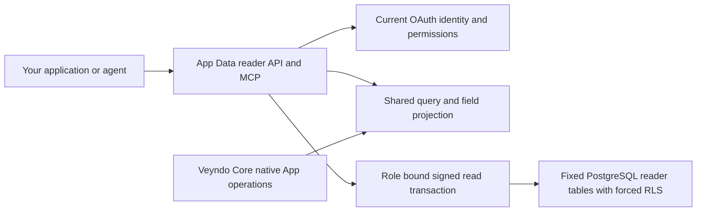

# Independent App Data: read records through API, MCP and JavaScript

Use installed App data in your own application or agent without running the
Veyndo Core. The independent Rust App Data reader exposes private list actions
through HTTP, OpenAPI, MCP and the existing JavaScript SDK.

The service lives in [veyndo/apps](https://github.com/veyndo/apps/tree/main/data-service).
It shares Veyndo's actual page preparation, declared-field projection and signed
database scope protocol. A fresh current OAuth merchant context and a restricted
read-only PostgreSQL login are required. Shop identity is resolved by the trusted
identity owner and cannot be supplied in the request.



## Managed writes and retained history

The [optional write profile](app-data-writes.md) now adds approved package-bound
record changes and historical reads through HTTP, MCP and the existing SDK. It
requires a deliberate schema/privilege upgrade and keeps native resource policies
with their actual owners. The default reader setup below remains unchanged.

## The developer journey

1. Provision a fresh dedicated PostgreSQL database and an existing restricted reader
   login. Run the versioned reader schema once with a separate migration owner.
2. Have the trusted App installation owner populate admitted packages, models and
   records. There is no public seed or installation shortcut in this reader.
3. Configure the fixed current OAuth introspection endpoint, private resource
   credential, resource audience, reader connection and private scope signing key.
4. Call the installed private list action. Use HTTP directly or the unchanged SDK.

The exact setup, role checks, configuration variables, key update procedure and
executable examples are in the [service guide](https://github.com/veyndo/apps/blob/main/data-service/README.md).

```http
POST /v1/records/query
Authorization: Bearer <current App Data token>
Content-Type: application/json

{"app":"advice","action":"list_notes","query":{"limit":20,"after":"note_001"}}
```

The optional query fields are `limit`, `after` and `id`. A page contains `elements`,
`limit`, `hasMore` and `nextCursor`. Only the current entity's declared fields,
record IDs and revisions are returned. Original localized values, empty strings
and null remain intact. Declared ontology output uses the existing common model
projection and does not create a second graph store.

The SDK's `client.tool('apps.records.read', input)` returns that same page.
MCP additionally requires explicit `mcp: true` on the installed action. HTTP and
MCP both check its private merchant, primary/additional permission and input
schema rules. The authenticated `/v1/contract` and `/v1/openapi.json` describe the
operation. The public health endpoint contains no shop data.

## One database boundary, independent and assembled

The reader schema has four fixed tables: one schema version marker and shared
packages, models and records. Every App, model and shop uses the same composite
keys. Adding a model creates no SQL table or index.

Serving code uses a nonowner login with no role inheritance, superuser, RLS
bypass, schema, temporary-table or write privileges. Each request sets one
short-lived role-bound signed database ticket inside a REPEATABLE READ READ ONLY
transaction. Forced row security checks that ticket independently of `rac.*`
settings. The package and its records come from the same snapshot. Current
membership and permissions are checked again on the next request; disabling a
package takes effect for the next request as well.

Veyndo keeps its existing installer, task-local identity, privileged provisioning,
pools, transaction owner and full object/privacy checks. Its native record pages
now call the same preparation and projection module, and its pool uses the same
original signing implementation. The historical native SQL migration is unchanged;
component-source verification also compares the shared SQL verifier with its
native source.

## Delivery scope

The default profile supplies the independent **read service and reader schema**.
The optional portable [write/history profile](app-data-writes.md) is now available.
Encrypted [settings](app-settings-service.md) and portable
[package review/install](app-package-installation-service.md) also have explicit
profiles. Full native-resource/jobs/restore/release hosting and automatic data
cutover remain open. The
complete standalone App lifecycle and marketplace durable host remain on the
[component task list](commerce-components.md). Models extending or referencing
native product, customer, order or company objects are denied until their actual
authorized resolver is connected. Extra token scopes do not bypass that check.

The published source, local process tests, container acceptance, native composition
and hosted deployment are separate evidence. This component does not provision a
new public database or service merely by being included in Veyndo.
[Acceptance](evidence/app-data-reader-component-2026-11-06.md).

## Optional encrypted settings

The [explicit settings profile](app-settings-service.md) adds current personal
live administrator reads and approved partial updates through HTTP/MCP/SDK. It
requires schema 3, the exact restricted grants and a separate operator vault key.
It is disabled by default; the schema-1 reader does not inherit these privileges.

## Optional portable package installation

The [explicit schema-4 profile](app-package-installation-service.md) reviews and
installs complete private data packages with the shared compiler and original
atomic installer. It supplies exact digest/permission/revision approval, immutable
versions and protected original row/byte budgets. Use the unchanged SDK to install,
configure and read/write an App without starting Core.
