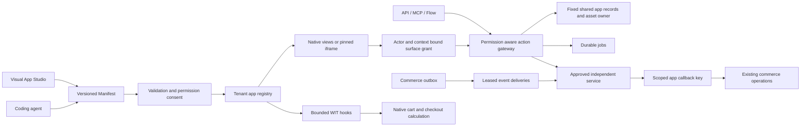

# The VEYNDO app platform

**Implementation status:** [Delivered foundations and remaining business-capability gates](app-system-status.md).

**Personal workspace and standard-shop editor:** [Illustrated workflow, shared models, rights, history, forms and publication](personal-workspace-and-shop-design.md).

An app is an immutable, reviewed Manifest. Studio, coding agents, API, MCP, Flow
Builder and storefront surfaces use that same contract. The public core owns
identity, data, pricing and execution admission. An independently deployed service
owns its external business logic. Private Payments and Storyfront implementations
remain in their private repositories.

## Complete standard compiler

Apps 0.16.0/model 0.12.0 provides `compiler::compile` for the complete Manifest.
All 19 original standard domain stages run in their original order; standard
validation is no longer implemented through host before/after callbacks. Required
policies retain actual native field/reference/currency/scope/source/base, signature,
namespace/destination/read-effect and clock decisions. First-error model kinds,
pointers and real host errors remain unchanged. Native identity, consent, current
reference ownership, actual module preparation/ABI verification and effects remain
with their original owners. The [independent full compiler example](https://github.com/veyndo/apps/blob/main/runtime/examples/package_compile.rs)
uses actual bounded Wasm kind parsing and all 34 native packages. Its host policy
is synthetic and rejects unsupported values/publisher signatures.
[Compiler evidence](evidence/app-complete-compiler-component-2026-11-06.md).

## Complete portable package contract

Apps 0.15.0/model 0.11.0 supplies the full strict `manifest::Manifest` used by
Studio, native installation, API/MCP and publication. Shared canonical fingerprints
and signature messages retain all original fields and defaults, including when
a downstream host enables ordered JSON maps. The storage
package delegates to that same fingerprint implementation. Publisher metadata,
semantic-version/dependency graph rules, passive artwork and payment declarations
are shared too. Signature verification is a mandatory trusted-host port; native
operator keys, exact service approval, current rights and financial effects retain
their existing owners. The [independent package example](https://github.com/veyndo/apps/blob/main/examples/package_contracts.rs)
reads all 34 native packages and checks a synthetic Ed25519 signature without Core
or SQL. [Integration evidence](evidence/app-complete-package-component-2026-11-06.md).

## Portable native lifecycle compiler

Apps 0.14.0/model 0.10.0 shares native order/quote lifecycle and accepted graph
contracts, bounded graph compilation and current-permission/fact narrowing.
A required policy supplies the native order base, scope catalogue and locale grammar.
Native adapters compute the digest from the complete admitted Manifest; accepted
snapshots preserve its exact app/version/digest through later updates. Actual
order-domain validation, identity, transaction locks and the final verified
transition predicate retain their existing owners. The independent
[lifecycle example](https://github.com/veyndo/apps/blob/main/examples/native_lifecycles.rs)
runs without a Core process or database. [Integration evidence](evidence/app-native-lifecycle-component-2026-11-06.md).

## Portable business contract checks

Apps 0.13.0/model 0.9.0 shares configuration fields, record selection, exact integer
arguments, typed commerce hooks and frozen business snapshots/expected decisions.
Runtime 0.2.0 uses that pure model for admitted snapshot-to-WIT projection,
actual frozen-example evaluation and bounded contribution execution. There is no
separate pricing implementation or inference-based acceptance path.

The [business preflight example](https://github.com/veyndo/apps/blob/main/runtime/examples/business_preflight.rs)
validates and executes the original configuration and commerce examples without
a Core process or database. Native installation and runtime adapters retain the
complete validation order, canonical currency/value/reference policies, real Wasm
source probing, selected library/package ownership, cache and transactional release.
[Business contract acceptance](evidence/app-business-contracts-2026-11-06.md).

## Independent execution package

Apps 0.12.0 supplies `veyndo-app-runtime` 0.1.0. It executes the same core-Wasm
approval/configuration and typed WIT commerce hooks used in Veyndo. Independent
hosts pass a required resource policy, explicit namespace configuration and
already-authorized snapshots. The runtime has no Core/kernel, SQL/network, WASI
or environment dependency. Native `crates/apps` adapts the original verified
predicate and operator configuration; preparation/cache, current identities,
package/digest checks, applying outcomes and release remain native.

The [standalone quote example](https://github.com/veyndo/apps/blob/main/runtime/examples/quote.rs)
runs a real component without Core or PostgreSQL. Native and independent paths
retain memory/table/fuel/epoch/host-call/snapshot/output limits and the same WIT
bytes. [Runtime acceptance](evidence/app-wasm-runtime-component-2026-11-05.md).

## Common package compiler

Apps 0.11.0/model 0.8.0 shares native view/control types, geometry, editor bindings
and bounded typed UI behavior. Native validation calls the same compiler with
its canonical field policies and verified public-read predicate. Payload projection
follows existing surface admission; runtime execution, current grants, records
and publication retain their native owners. The independent
[native editor example](https://github.com/veyndo/apps/blob/main/examples/native_views.rs)
runs without a Core binary or database.
[Native view/behavior evidence](evidence/app-native-views-component-2026-11-05.md).

Apps 0.10.0/model 0.7.0 shares Surface/ApiRoute types and placement/route
validation. Required host policies resolve native views, team scopes and read-only
effects; the native adapter retains the verified predicate. Shared native view
compilation is described above; actor/context grants, pinned UI, current package authority and action execution
remain separate native owners.
[Placement/HTTP component evidence](evidence/app-surface-contracts-2026-11-05.md).

Apps 0.9.0/model 0.6.0 shares native object-binding declarations, strict AI
metadata and namespaced graph mapping/projection. Native authorized lists and
object-extension projections supply current rows; native current object/PII rights,
reference ownership, MCP/agent admission and verified configuration release retain
their existing owners.
[Object/graph component evidence](evidence/app-object-graph-contracts-2026-11-05.md).

Apps 0.8.0/model 0.5.0 also shares strict event filter/delivery contracts,
subscription and payload minimization, clock-injected UTC schedule validation and
private webhook declarations. Destination admission requires the host's explicit
policy. Native installed-package dispatch, signing/verification, current authority,
durable queues/ticks and replay receipts retain their owners.
[Event/trigger component evidence](evidence/app-event-contracts-2026-11-05.md).

Apps 0.7.0/model 0.4.0 also owns strict settings declarations/updates and
secret-safe projections, plus explicit schema evolution planning and exact value
conversion. The native setting routes and upgrade review/install paths reuse the
same implementation. Encryption, authenticated authority and actual checked
transactional data changes remain native.
[Settings and upgrade extraction](evidence/app-evolution-settings-2026-11-05.md).

Apps 0.6.0/model 0.3.0 supplies `package::compile`: the original common metadata,
capability, model/index/configuration, action schema/privacy/effect, legacy-slot
and event grammar. It requires trusted scope/reference/Wasm-kind policies and
ordered before/after host extension checks. Native `manifest_validation.rs`
provides every original domain extension validator around that shared grammar.
The borrowed common projection comes from the complete shared strict Manifest
described above. Final native domain policies, provider approval and current
installation consent remain authoritative. [Independent and integrated acceptance](evidence/app-package-compiler-2026-11-05.md).

## Shared atomic installation

Apps 0.5.0 owns the installation sequence consumed by native installation, hosted
app setup, private preview, staging/release and upgrade review. Required host hooks
preserve the existing compiler/trust and commerce lock before package locks,
dependency/lifecycle checks under those locks, checked data migration, model
attachment, default configuration and schedule synchronization. The component
owns the original tenant/package locks, quota, immutable version check and package,
version and `app.installed` persistence. Every stage uses the caller transaction;
any error must roll it back. Native private preview authorization controls the
mutable version mode. [Acceptance and remaining host work](evidence/app-installation-component-2026-11-05.md).

## Shared admission and package fence

The Apps 0.4.0 component supplies Action types and shared admission through
trusted-host current-identity/scope ports. Native authentication resolves the
principal; app input cannot provide its authority implementation. Callback scope
planning retains declared consent, PII pairing and current role checks. The native
verified callback predicate still combines separate consent and role facts.

The component also supplies the existing active-package lock/read and canonical
fingerprint. Native full typed digest comparison, reserved/provider trust,
installation consent, key issuance and revocation remain with their existing
owners. [Integrated tests and remaining standalone host work](evidence/app-admission-component-2026-11-05.md).

## Install and update

`POST /api/apps/review` with `builtIn` or `manifest` returns the Rust-canonical
package digest, complete permissions, added permissions and previous version.
`POST /api/apps` requires `approve: true`, that exact `digest` and the complete
`permissions` list. Current actor rights are checked independently. A stale review,
changed package or permission mismatch fails before installation. Apps shows this
review in a consent dialog. Version identifiers cannot be reused with different
content. Deactivation retains data and checks dependent apps/hosted frontends.

Reserved bundled names, including payment apps, cannot inherit operator authority
from a merchant-authored lookalike. A service configuration needs its own
`approvedDigests` pin even when a publisher has signed the package.
[Security, migration and operator configuration](app-security.md).

## Data and core capabilities

Each tenant/app/model has a versioned logical contract in four fixed shared PostgreSQL
tables. Equal app IDs can retain incompatible types in different shops without
shared-column conflicts or per-shop tables. Records, fixed lookup/unique projections
and ordered relationships use full tenant/app/entity keys, forced signed RLS,
transactional quotas and native composite foreign keys. No app creates SQL objects.
[Storage design, capacity and coordinated existing-data migration](app-data-storage.md).

Models support strings, integers, booleans, bounded JSON, date, datetime, decimal,
explicit-scale integer money, rich text, image/file references and multi-relations.
Validation rules and uniqueness run on the server. Image/file fields reference the
existing product asset owner; contextual multipart uploads are private by default.
A public model cannot silently expose a private asset. Lists use bounded keyset
pages, indexed filters and optimistic record revisions.

Explicit schema steps can rename/remove/convert/fill fields from an exact installed
version. Every record is validated before model/data changes. Installation, schema,
recovery snapshot and outbox commit atomically. The online path is bounded to 2,000
records/model, 4 MB/migration and retained recovery storage of 16 MB/app. Relation
changes and larger migrations require an offline plan. Recovery snapshots are not
an automatic one-click rollback of external service effects.

### Check an upgrade before installation

The package consent dialog now runs the native installer against the current
shop in a rollback-only transaction. App Studio also offers **Check before
installing** for each immutable build in its owned stage. The report shows stored
record counts, whether a migration is needed, its declared step count and the
first blocking diagnostic. It returns no record contents or credentials.

For a selected stage, ownership metadata is checked inside the same privileged,
rollback-only transaction as installation admission. The parent still comes from
the authenticated workspace; `apps.manage` and `developer.manage` remain required.
Foreign, missing and actor-private preview stages retain the ordinary rejection.
The check runs with actual separate system/tenant logins and transaction poolers;
the tenant connection is not granted cross-stage metadata access.

This is the actual migration/admission path, including stored-value conversion,
fixed-storage constraints, publisher/dependency checks and saved configuration or
commerce examples. Deferred constraints are checked before the entire transaction
is rolled back. No package, record, recovery snapshot, schedule, payment method or
outbox event is committed by the check. Compilation caches may retain bounded pure
Wasm code; no external provider action is executed.

Every installation transport and selected release also checks active Flow actions
against the proposed package under the existing automation fence. The same Flow
argument construction and native field validation apply to configuration save and
replacement. The stored Flow actor's current membership, primary and additional
action rights and core-extension access must still permit that action. A missing
or incompatible action blocks activation. Queued work
continues to use its ordinary current-rights and package admission; checking an
upgrade does not grant future authority or replay a previous external effect.

Changing a field's validation rules also requires an explicit schema migration.
The bounded migration checks stored values through the ordinary field/language
validator and retains its recovery snapshot. Invalid old values must be repaired
before activation. An update cannot remove an enabled payment provider/method or
narrow its configured currency/country coverage, including channel overrides.
Disable or reconfigure the affected method first. Disabled methods and immutable
historical payment attempts retain their existing contracts.

The report is a snapshot, not approval. Installation rechecks current state and
still needs exact candidate digest/permissions. Restore a previous interface as a
new immutable version. Restoring data needs an explicit compatible migration;
never downgrade or rewind orders, payment effects or installed setting values.

An app can request a separate callback key under **Apps → Access**. Keys are
app/tenant/package bound, expire within 90 days, show plaintext once and intersect
scopes with the creator's **current** membership rights. Upgrade, revocation or
membership removal invalidates access. They cannot call ordinary merchant endpoints.

| App capability | Core operation / boundary |
|---|---|
| `products.read`, `products.write` | Existing product content/read/save operations; native revisions and catalogue rights |
| `orders.read`, `customers.read` | Bounded projections of owned core objects |
| `orders.read` + `customers.pii` | `delivery_snapshot`: current native package/address and allocation digest |
| `deliveries.write` + `documents.create` + `customers.pii` | `delivery_reserve`/`delivery_release`: freeze an own open package before a carrier effect; only the original app intent may acknowledge/release it |
| `deliveries.write` + `documents.create` + `customers.pii` | Bounded multipart `document_upload`: existing private order receipts, package allocation CAS/fence, tracking, immutable PDFs and app storage quota |
| `customers.pii` | Separate consent plus current actor permission before personal fields are returned |
| `assets.read`, `assets.write` | Existing asset metadata/private content and validated contextual multipart upload |
| `jobs.write` | Claim/progress/completion of this app's admitted jobs |
| `events:self`, `events:order.*`, exact event scopes | Subscription selection; sensitive payload fields still require separate data rights |
| `commerce.hooks` | Bounded WIT price/discount/shipping/validation hooks |

Callbacks live at `/api/apps/APP/core/OPERATION`. The callback identity does not
become a merchant session. JSON aliases, MCP tools and flows call declared actions
through the same gateway; `mcp: false` and `flowAllowed` remain explicit.
Multipart uploads use a dedicated surface/core upload route, not a JSON MCP tool.

## Surfaces and native views

App modules can appear in navigation and existing product/customer/order editors,
storefront pages, product details, cart summaries and account areas. The existing
[assistant guide](app-assistants.md) lists all placement names. Each surface declares
its own action allowlist and optional team permission.

The host obtains a five-minute grant bound to tenant, app, current actor, package,
surface and context IDs. The server enforces the same allowlist and rejects changing
`productId`, `customerId` or `orderId`. Grants are not general callback keys.
Native views share the host renderer, translations and data owner. They include
text, tables/cards/forms, inputs, buttons, images, frames/tabs, KPI and charts.
[Visual builder, F5 previews and code-behind](app-studio.md).

Custom UI remains an opaque iframe. The host fetches only approved hash-pinned,
self-contained HTML, with CSP denying direct fetches/forms and sandbox limited to
scripts. The message bridge binds source/nonce and surface actions; no merchant
credential is passed to the guest. Only reviewed publishers should receive sensitive
permissions: browser CSP does not prove that hostile guest code cannot disclose data
through every form of navigation. Arbitrary customer-private external service
identity and hostile-code microVM hosting are not implemented by this contract.

## Events and long actions

The PostgreSQL outbox feeds leased deliveries. Each process has eight delivery
lanes, bounded per-tenant selection, batches of 1–25, stable per-event idempotency
keys, 30-second fenced leases and exponential retry up to eight attempts. A slow
service does not hold a database transaction or the sole global event lane.
Filters run on the permission-projected payload. Replay checks current permissions
and processes up to 50 events per request, preserving original IDs.

Subscriptions cannot see other apps, team changes or personal customer fields by
requesting only coarse `events.read`. Own events use `events:self`; core families
need their declared scope. Receiver code validates the **whole** batch before effects.
Delivery is at least once; the receiver must deduplicate persistent effects.

An optional signed public HTTPS destination needs `events.send`, consent and a
rotatable encrypted outbound secret. Egress rejects private/reserved addresses,
mixed DNS answers, redirects and ambient proxies; connections pin resolved addresses.
[SDK signature format and examples](../extensions/README.md).

An action with handler `job` admits a durable job with an idempotency key. The app
receives a minimized job-ID event, claims a fenced lease and reports progress via
its scoped callback. Cancellation must be acknowledged by a running service.
Expired leases produce **uncertain**, not an automatic replay of external effects.
Apps shows progress, results, review/retry/archive and private artifact downloads.
Limits are ten active jobs/app, 100/tenant and 1,000 retained jobs/app.

## Pure commerce components

[`veyndo:commerce/extension@1.0.0`](../extensions/sdk/wit/commerce.wit) defines
read-only cart, product and explicitly declared app-record snapshots. The four hooks
return an accepted flag, integer money adjustment and bounded reason code. The core
checks currency/scale, bounds and validation semantics, then uses existing native
allocation/tax/delivery code. Checkout retains stock, payment and idempotency owners.
No arbitrary SQL, network, filesystem or mutable commerce host functions are imported.

Components compile before the checkout transaction, use digest-cached shared engines,
pooling, fuel, epoch deadlines, 1 MiB memory and 10,000 table-element limits. Eight
active hook apps/tenant are admitted; record snapshots are bounded to four/app and
host reads to 128/instance. Declared record revisions are included in quote outcomes.
The [snapshot-pricing example](../extensions/apps/snapshot-pricing/manifest.json)
and typed WAT component run through real quote and order paths. General Rust/PHP
source builds and arbitrary asynchronous hooks are external deployment concerns.

## Publisher distribution

Registered publisher public keys are configured by the operator in `APP_PUBLISHERS`.
A signed package uses `publisher_app` IDs, key ID, stable/beta/development channel,
Ed25519 signature and semver dependencies. Sign with `veyndo --sign-app MANIFEST`
using a private base64 seed on stdin; never commit it. The signed message binds the
entire Rust-canonical package including permissions, bundles and dependencies.

The registry rejects unsigned occupancy of registered namespaces, wrong signatures,
missing/wrong-publisher/foreign-tenant dependencies, cycles, incompatible upgrades
and deactivation of required dependencies. Channels are signed metadata; there is
no automatic marketplace update-feed deployment. A local unsigned merchant app is
still allowed outside registered namespaces and has tenant-specific storage.

## Examples and evidence

- **care-studio**: native forms, public product care cards, API/MCP and multilingual content.
- **product-lab**: independent custom UI, managed data, product context and event inbox.
- **service-example**: approved pinned UI, scoped gateway and validated deduplicated batches.
- **snapshot-pricing**: actual typed WIT host reads and all four commerce hooks.
- **catalog-export**: leased job → product callbacks → private native asset → downloadable result.
- **Email / Slack / Google / Gmail**: bundled Rust connector services, precise subscriptions and batch validation.

Registered HTTP suites cover tenant collisions, resource attacks, consent, private
F5 records, callback PII/revocation, migration rollback, file boundaries, jobs,
publisher dependencies, payment/staging compatibility and slow-receiver isolation.
These are concrete prototype regressions, not production-scale measurements or a
claim of complete Shopware parity. [Test registry](testing.md), [source owners](source-map.md).

## Graph-native app views

An optional `intelligence.ontology` in the **same versioned manifest** maps up to
four AI-enabled entities to app-owned node types. Select up to 16 native fields;
optional `relations` maps selected native/core reference fields to app-owned edge
types. Identifiers stay under `app.<app-id>`, so an app cannot impersonate a native
product fact. Strings and native multi-relation arrays generate edges; they expose
only stored reference IDs, without fetching a target or bypassing target rights.

The authorized native list adds a bounded `ontology` view (24 rows, 16 KiB,
whole-record omission count), with tenant, package version and current native
record revision. HTTP, MCP and merchant planner context use that same projection.
Current package activation, action permissions and PostgreSQL RLS apply first.
A public list deliberately exposes selected fields; a private list remains private.
Empty optional metadata preserves existing package serialization and response shape.

App Studio uses the shared content-language editor for graph labels, selected field
controls and optional edge types; imported coding-agent JSON follows the identical
contract. Model rename/delete and field removal update draft references, without
silently selecting replacement fields. Empty selections fail package review.

These records carry `native-app-records-not-confirmed-product-claims`. Mapping a
model does not confirm a product claim, extract unstructured facts, add a second
graph store, or provide global graph traversal. See the [care knowledge example](../extensions/apps/ontology-care/README.md)
and real two-tenant API/MCP suite `scripts/app_ontology.py`.

[All-app folder ownership and runtime boundaries](plugin-ownership.md).

## Provider-neutral shipping example

The [shipping assistant package](../extensions/apps/assistant-examples/shipping.json)
declares native jobs and delivery/document consent. No carrier service is bundled.
A provider's protocol, private configuration, booking receipts, UI and tests belong
to its app package. Reuse native jobs and order-document callbacks; do not create a
second authoritative fulfillment or work queue.
`GET /api/apps/APP/jobs/JOB` admits the original actor or an app manager with current
action rights/digest; it omits input and leases and reveals results only after
success. Manager job lists also hide messages/results when current action rights or
package binding no longer permit them. Private jobs and fulfillment records cannot
be staged or released. See [partial shipments and failure recovery](shipping-workflows.md).

### Insertable native shop elements

Apps may expose `storefront.block` surfaces with `uiPath: "native/<view-id>"`,
`storefront.slot` consent and public declared actions. They appear as illustrated
cards in Shop design. Page documents reference the app/surface; the existing registry,
native renderer, action grants and permission checks remain authoritative. Editor
preview grants narrow access to read-only actions. A public element cannot expose
private actions or arbitrary HTML/service iframes. See the [illustrated workflow](personal-workspace-and-shop-design.md#illustrated-elements-and-compact-panels)
and `extensions/apps/ontology-care/manifest.json`.

## Declared app configuration and bounded installation

An app can declare up to 16 typed `settings` fields (localized label, key, kind and
required flag). Values are managed under Apps → installed app → App settings through
`GET/PUT /api/apps/{app}/settings`. The host reuses `apps/settings.rs`, the encrypted
`apps/secrets.rs` owner and migration 096; it does not create a second settings store.
Current personal `team.manage`, active digest, explicit approval and optimistic
revision are required for writes. Configuration values are live-only operational
state, excluded from native preview/release records, agent exports and public views.
Only declared private service actions receive `_appSettings` server-side. Native
browser views never receive secret values. See [security and setup](app-studio-workspace.md#app-settings-after-installation).

Registered package IDs are capped at 128 per tenant under the existing installation lock;
updates to existing IDs remain possible at the cap. A package may declare at most
64 indexed/unique fields. Existing limits remain: 12 models, 16 fields/model,
100,000 stored rows and 64 MiB per tenant/app. These controls bound logical data and projection growth; fixed indexes replace
per-installation DDL. They do not prove unlimited capacity.

## Native object fields

Use the optional version-1 [core object extension contract](app-core-extensions.md) for namespaced private product, customer, order and company fields. Native details, existing directory columns, exact filters and MCP reads reuse the installed model and current rights. Operational customer/order extension records are never configuration release units.

## Native operational workflows

Optional [version-1 native lifecycles](app-native-lifecycles.md) add app-owned order and RFQ review steps through existing native transitions, current rights and per-object accepted version snapshots. They do not replace native payment, stock, refund or buyer acceptance.

### Job-bound completion evidence

An approved app callback can include `evidence: {action, input}` in a successful
`job_progress` callback. The job's frozen input must declare the exact
`evidenceRecord: {entity, id}` destination. The declared private native save action
and current job creator need ordinary data/action/entity rights; record CAS,
quotas/references/history and package fencing remain in the shared owner.
Completion and save commit together. A cancelled, stale, revoked or conflicting
job commits neither. The stored entity declares an optional string `evidence`
field; Core fills it using the existing platform authenticated encryption key.
`POST /api/apps/{id}/core/job_evidence` accepts `{entity, ids}` (at most 100) and
returns only verified current record IDs/revisions/job IDs. Callers still need
current app and original job-action rights. Ordinary edits invalidate the seal;
raw merchant-authored success flags are never authoritative. The service remains
a separately trusted operator-approved observation producer. No new physical app
table, credential authority or queue is added. Preserve `PLATFORM_SECRET_KEY` across
restarts; key rotation needs deliberate evidence revalidation.

## Independent durable job history and control

Apps 0.17.0 supplies actual scoped history/detail queries and the merchant control
transaction. Native routes call that same package. Cancellation, explicit review
of uncertain outcomes, retry, archival, row/revision fences and outbox writes do
not have a second native implementation. The required retry hook checks the
current installed action, primary/additional rights and stored input before
requeueing. Core keeps current package/actor admission and message/result redaction.
Callback leases, creator-role checks, signed identities and sealed completion
records keep their existing owners. [Acceptance and runnable example](evidence/app-job-workflows-component-2026-11-06.md).
