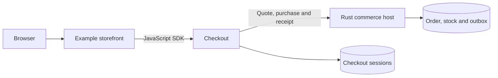
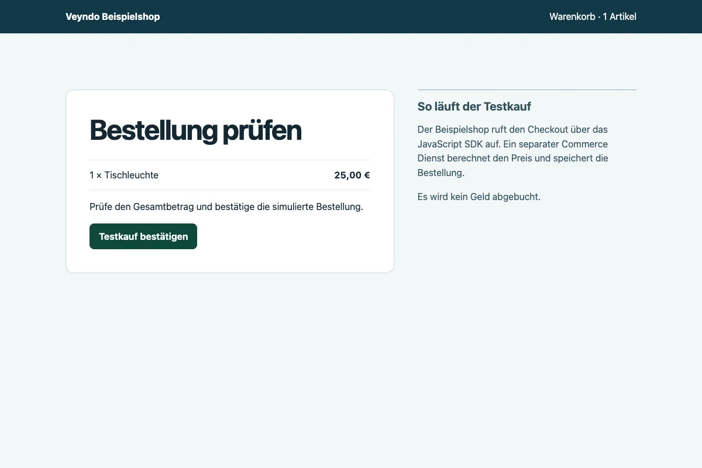

# Independent checkout service

The local reference storefront completes a simulated purchase through the
independent Checkout service and a separate commerce host. The
[component plan](commerce-components.md#checkout-independent-service-and-ui)
tracks the shared embeddable UI, provider coverage and hosted acceptance.

Checkout has its own target repository `veyndo/checkout`, Rust service, HTTP API,
MCP tools, JavaScript/TypeScript client and embeddable checkout UI. It must run
without starting the complete Veyndo product or reading private Core tables.
It must also compose into native Veyndo, Storyfront and external frontends.

## Domain ownership

Checkout owns versioned checkout sessions, cart/quote orchestration, progress and
customer-facing purchase/recovery state. It consumes explicit ports for catalog,
pricing/tax/promotions, inventory/reservations, customer/company policy, delivery,
orders/documents, legal context and Payments. These ports may target independently
released Veyndo components or another admitted backend. “Standalone” means usable
without the whole product, not a checkout that invents catalog, stock or prices.

Keep one owner of every financial/stock/order decision. Checkout must not create a
parallel pricing engine, payment ledger, order writer or unreliable browser queue.
Existing currency/minor-unit, language/country, B2B approval, Rule/Flow, channel,
rights and package-hook behavior remain authoritative through their domain owners.

## Commit boundary

The existing native purchase commits order, stock and outbox atomically. Splitting
a process does not turn this into an atomic transaction across unrelated databases.
Define one `CommitOrder` port whose domain owner retains those writes and replay
receipt in one transaction. In the composed product that remains the existing
commerce owner until its equivalent component is accepted.

External catalog, inventory and order integrations need explicit reservation
leases, expiry, idempotency, confirmed outcomes and recovery wherever those
operations cross transactional owners.

Checkout may store its own sessions and frozen quote references. Payment intents,
provider receipts, captures and refunds stay with Payments. Uncertain provider
outcomes are persisted/fenced and recovered; they are never blindly retried.
Expected cart/quote versions and current channel/customer/company authority must
be rechecked at purchase, not inferred from an earlier UI preview or model output.

## Commerce host ports in Core

Core exposes the host operations as a single commerce boundary. Checkout makes
one host call for a quote, one for confirmation and a separate receipt call
when the original result needs recovering. The normal storefront and
Storyfront still reach the same transaction directly.

| Port | Commerce responsibility |
| --- | --- |
| Quote | Resolve the current buyer and cart, channel, catalogue, pricing, delivery, company policy and legal context. Return the cart revision, amount in minor units, currency scale, country, legal policy version and payment method. The preview reserves no stock. |
| CommitOrder | Recheck the review and buyer in the native transaction. Lock stock in native product order and commit the order, stock allocation, completed cart and outbox event together. The session ID gives the purchase its replay key. An altered review cannot replace an original receipt. |
| Receipt | Read the original order by its indexed shop and purchase key, then check the original cart, channel and current buyer. Only the buyer credential is needed for recovery. A missing receipt is a read result, not proof that an in-flight confirmation failed. |

Core supports the simulated payment method and an explicit PayPal Sandbox
profile. Payment attempts, provider callbacks and refunds use the existing
Payments owner. The independent Checkout process keeps draft sessions in its
own database and uses HTTP for the three Commerce operations. Core requires
no new schema or synchronous dependency on that process. If a response goes
missing, recover the receipt or retry the exact reviewed purchase with the
same session. A new session can represent a different purchase.
See the [Northflank rollout and public purchase results](status.md#commerce-host-ports-for-independent-checkout-9-november-2026).

## How native and embedded checkout share one order

The normal storefront and the original Storyfront Experience enter Commerce
through different screens. Both use the same quote, order and payment owners.
The independent Checkout service can use those owners through the commerce host
contract below. The public journeys described here use Core directly.

| Step | Normal storefront | Storyfront |
| --- | --- | --- |
| Cart and identity | Storefront keeps the native cart credential in its shop context. | Core issues a short-lived, single-use transfer for the current cart revision and registered parent origin. Consuming it rotates the credential and keeps the cart ID. |
| Quote and legal review | The buyer reviews the native cart revision and total. Commerce calculates delivery, taxes and available methods and resolves the current legal context. | The embedded native checkout uses the same quote and review contract after transfer. Its origin and shop scope are checked before loading. |
| Order and payment | `POST /store-api/checkout/order` checks the reviewed revision and amount, records the legal snapshot and commits the order, stock and event. A retry with the same purchase key returns the original receipt. | The embedded form uses that same order endpoint and payment attempt. The handoff does not create another order or payment ledger. |
| Return and recovery | The storefront shows the confirmed receipt and clears its cart view. | The Experience clears its originating bag after it verifies Core's result. `POST /store-api/checkout/handoff/recover` can retrieve the original result after a lost browser message. A read needs no cart lock. An explicit reopen acquires that lock to fence the older frame. |
| Refund | Studio submits an approved command against the original payment attempt. `POST /api/payments/{id}/refund` requires `payments.manage`, explicit approval and an idempotency key. | The merchant uses the same Studio command for a Storyfront order. The buyer's checkout credential cannot issue a refund. |

The local [handoff regression](https://github.com/veyndo/veyndo/blob/main/scripts/checkout_handoff.py)
compares equivalent native and transferred carts in one shop. It rejects a
changed total in both paths and verifies matching quote options, localized line
snapshots and simulated payment state. Each confirmed purchase produces one
order, the expected stock decrement and one `order.placed` event, including
after a replay. The same suite checks lost messages and concurrent recovery.
See the [public browser results](status.md#native-and-embedded-checkout-compatibility-9-november-2026)
and the separate [configured provider acceptance](storyfront.md#accept-a-hosted-release).

## A purchase with a separate commerce host

The local reference uses two Rust processes and two PostgreSQL databases. The
Checkout service keeps the buyer's draft. The reference host supplies current
buyer and cart admission, an exact price in minor units, and one commit for the
stock decrement, order and outbox event. The same Rust purchase orchestrator
also runs in the Veyndo composition. A host can supply its own rules through
the orchestrator's required ports.

| Host operation | What it returns |
| --- | --- |
| `POST /store-api/checkout/session-quote` | Current amount, revision, channel and review policy for the buyer's cart. |
| `POST /store-api/checkout/session-order` | A receipt after explicitly reviewed confirmation. An exact replay returns that same receipt. |
| `POST /store-api/checkout/session-receipt` | The original receipt for the current buyer and checkout session. The cart credential is unnecessary here. |

The test reads the quote through HTTP and MCP, rejects a changed amount and
then sends two confirmed purchases for the last unit. It drops the successful
response after commit. After both processes restart, the JavaScript SDK reads
the same receipt. One stock decrement, one order and one event remain in
PostgreSQL. A revoked buyer can no longer retrieve the receipt.

## External reference storefront

The browser calls its own shop server. The server uses the [JavaScript SDK](https://github.com/veyndo/sdk)
to contact Checkout and keeps the buyer credentials on the server. A signed,
short-lived approval carries the exact price and revision the buyer reviewed.
Checkout uses the independent Rust host for current pricing and the final commit.



The browser test reviewed the 25 EUR cart and confirmed once. After the
response was dropped, the shopper recovered the original receipt and returned
to an empty cart. Reload recovered the same receipt. Desktop and mobile
layouts were checked in Chromium. Restarting all three processes also
preserved the original receipt, with one stock decrement, one order and one
event in PostgreSQL. A changed quote and an altered approval were rejected
before an order was written.



The sample uses a single synthetic buyer and one disposable cart on loopback.
The [Checkout repository setup guide](https://github.com/veyndo/checkout/pull/2)
is available to repository collaborators. Public shop and Storyfront buyers
continue to use the integrated commerce paths.

The existing Veyndo composition also passed local purchase, capture and refund
with PayPal and Shopware Payments fixtures. Under concurrent catalogue reads,
both paths completed 192 quote requests without errors. The local p95 was
43.7 ms through Core and 47.3 ms through Checkout. This run used local
PostgreSQL, synthetic identities and the same cart and quote on both paths.
[Measurement method](evidence/checkout-composition-performance-2026-11-08.md).

### Combine checkout and an installed MCP App

The public [Connected Shop example](https://github.com/veyndo/sdk/tree/main/examples/connected-shop)
starts a separate Node host. It uses the SDK 0.4.6 catalog client to display
a Core product family and the MCP client to load its filterable guide.
The Checkout client previews and applies the chosen basket. The shopper reviews
Core's total and delivery before confirming through the Store API relay
to independent Checkout. If the Core reply is lost, the host looks up
the original session receipt.

The local browser test used separate Core and Checkout PostgreSQL databases.
Desktop and mobile each completed one simulated purchase of the selected
product. Each reduced stock once. On mobile the Core response was discarded
after successful confirmation. The host recovered the same receipt, and
reload preserved it. A forged product from the iframe and a confirmation
from an unrelated browser origin were rejected.
[Browser verification with SDK 0.4.6](status.md#connected-shop-with-the-typed-sdk).

## UI and agent integration

Export the same cart, address, delivery, payment, review and completion controls as
an independent application and an embeddable UI. An external frontend supplies
its theme and admitted cart context through the shared UI host; Veyndo and the
original Storyfront use that same API/UI implementation. Provider-specific hosted
fields, wallets, required redirects and authentication remain supported by their
actual provider adapters.

An embedded checkout confirms completion only after authoritative server order
state. Return navigation and clearing the originating cart use a verified session/
order receipt and scoped message handshake. A browser message or URL fragment
alone never proves purchase. Support native and embedded return, refresh/restart,
expired carts, repeated callbacks and a stale original cart without duplicate orders.

The [hosted release checklist](storyfront.md#accept-a-hosted-release) verifies the
existing Storyfront path before and after the Core update. The
[Storyfront recovery contract](storyfront.md#responsibilities-and-contracts) lets the parent find
the original cart when a browser notification is lost. Status reads use the last
committed state without locking the cart. Only an explicit reopen takes the same
cart lock as purchase and rechecks the recovery key before replacing a transfer.
This keeps frequent status reads out of the order write path.

The agent may configure checkout, explain totals, obtain missing data and prepare
an action or validated interface. Deterministic controls remain usable when the
model is unavailable. Purchase, saved-method consent and financial changes need
their actual current user approval and backend checks. Agent-produced totals and
payment status are never authoritative.

## Current buyer, channel and company authority

An independent Checkout draft carries the reviewed cart and its context.
Commerce checks current buyer and channel access on the next call and applies
company approval and budget rules inside the existing purchase transaction.
A repeat of the approved purchase returns its original order. Reading the
receipt still requires the current buyer identity.

| Change in the test shop | Observed result through separate Checkout |
| --- | --- |
| Approval missing or superseded by a membership change | Purchase declined with no order, stock allocation or Flow job. |
| Buyer removed from the company after approval | Quote and confirmation declined using the original credentials. |
| Channel made private or inactive | The previously reviewed cart could no longer be quoted or confirmed. |
| Budget reduced or whole shop paused | Direct and composed purchases declined before writing an order. |
| Fresh approval after the cart changed | One order, one stock allocation, one completed Flow and a customer-visible invoice. Repeated confirmation returned the original receipt. |
| Customer logged out after purchase | The old customer session could no longer read the receipt. |

The local acceptance used separate Rust processes, signed PostgreSQL access and
a synthetic shop. It also exercised a lost confirmation response and capture
and refund with local PayPal and Shopware Payments fixtures. The public
Storyfront smoke test separately opened the native checkout in 806 ms and read
the original open cart in 16 ms. Provider acceptance for the new hosted pair is
tracked under [CHK-08](commerce-components.md#checkout-independent-service-and-ui).

In a paired local comparison with concurrent catalog reads, both paths completed
192 quotes without errors. The p95 was 45.6 ms for native Core and 46.9 ms through
the separate Checkout process. [Measurement method](evidence/checkout-composition-performance-2026-11-08.md).

## Pause and resume Checkout confirmation

The separate Checkout process has two opt-in confirmation profiles. Set
`CHECKOUT_ENABLE_SIMULATED_PURCHASE` and
`CHECKOUT_ENABLE_PAYPAL_SANDBOX_PURCHASE` to `false` on that process and restart
it to stop admitting new confirmations. Keep the same session database,
identity and commerce origin. Keep Core and its provider workers running.
Checkout hides confirmation from OpenAPI and returns HTTP 503
(`purchase_disabled`, `mayHaveApplied: false`) for a blocked request.
Session, quote and receipt reads are available once Checkout is ready.

A response lost before the pause can still belong to an order that Core
committed. Look up the receipt with the original session and current buyer.
Core continues to reconcile the same payment attempt. After re-enabling
confirmation, reuse the original session and purchase identity for a valid
review. A new purchase on another route uses a different identity.

The local rehearsal prepared two native carts before the switch. With
Checkout offline, Core purchased the first directly and the second through
its existing Storyfront handoff. Handoff recovery returned the original
order and cart. Core also reconciled an existing PayPal fixture approval
during the outage. With confirmations still disabled, Checkout read the
captured payment and its subsequent refund. Re-enabling returned the same
order and payment attempt and let a retained draft complete. The checks
compared order and payment IDs and stock across the switch.

The [component plan](commerce-components.md#checkout-independent-service-and-ui)
tracks the hosted routing switch and rehearsal against the configured provider.
The local handoff test exercises the Core transfer and purchase API. The
external browser example separately verifies return to an empty cart.

In the same local run, both paths completed 192 quotes alongside catalog
reads with zero errors. The p95 was 48.8 ms for native Core and 48.2 ms
through Checkout. During a separate Checkout stop, 32 native quotes and
32 catalog reads also completed without errors. These timings describe
the local fixture.

## Required acceptance

- Its own image/configuration/session store, HTTP/MCP contracts and SDK examples.
- Independent external frontend example and actual Veyndo/Storyfront composition.
- Identical domain validation and replay semantics across HTTP, MCP and UI.
- Own/foreign shop/customer/channel/cart cases, paused/private shops, revoked
  rights, stale versions and B2B budget/approval changes.
- Concurrent purchase, stock contention, recalculation, legal/version receipts,
  outbox/Flow and document behavior without a second order/stock writer.
- Payment approval/cancellation/unknown outcome, supported methods, callback
  authentication, return, empty originating cart and refund integration.
- Real reference adapter/database/provider fixtures for automatic tests; configured
  provider acceptance remains distinct from fixtures and simulated payments.
- Controlled migration of existing routes, cart capabilities, pending payment
  attempts and receipts, with rollback. Do not invalidate active carts at cutover.

This component uses [the common agentic UI contract](agentic-component-ui.md).

## Bind Checkout to a native buyer login

Core can issue a five-minute Checkout grant for a signed-in buyer in a configured
live shop. Enable the canary with the following Core settings.

| Setting | Value |
| --- | --- |
| `CHECKOUT_IDENTITY_SHOPS` | Comma-separated live shop IDs explicitly enabled for the canary |
| `CHECKOUT_IDENTITY_KEY` | 32 random bytes encoded as unpadded base64url, held only by Core |
| `CHECKOUT_INTROSPECTION_TOKEN` | Separate random service credential of at least 32 printable characters |

All Core replicas use the same settings. The shop calls
`POST /store-api/checkout/session-access` using its existing buyer login and the
normal same-origin and CSRF headers for an HttpOnly session. It receives an opaque
`access_token`. Keep this token in memory and send it as the Checkout service's
Bearer token. For a quote or confirmation, also send it in the service's
`x-customer-token` header alongside the native cart capability. Receipt recovery
only needs the grant. A new login can obtain a fresh grant for the same buyer and
recover the existing receipt.

Configure the separate service with audience `veyndo-checkout` and
`CHECKOUT_INTROSPECTION_URL=https://<core-origin>/api/identity/checkout/introspect`.
Supply the same introspection credential and the exact Core commerce origin.
The native buyer cookie and the encryption key stay with Core. Introspection
and the native checkout ports recheck the original session in PostgreSQL. An
expired, revoked or foreign-shop grant cannot be used to read an account, mint
another grant, or purchase another buyer's cart. Checkout keeps its existing
dedicated draft database.

### Route a test shop through private Checkout

Keep the Checkout listener private. Configure the runtime on the two services:

| Service | Runtime setting |
| --- | --- |
| Core only | `CHECKOUT_PRIVATE_ORIGIN=http://veyndo-checkout:8810` and `CHECKOUT_IDENTITY_SHOPS` with the exact test shop ID. |
| Core only | `CHECKOUT_IDENTITY_KEY` from 32 random bytes encoded as unpadded base64url. Core uses this key to issue five-minute buyer grants. |
| Core and Checkout | The same `CHECKOUT_INTROSPECTION_TOKEN`, a distinct random service credential of 32 to 256 visible ASCII characters. Restrict access to these two runtimes. |
| Checkout only | `CHECKOUT_AUDIENCE=veyndo-checkout`, `CHECKOUT_COMMERCE_ORIGIN=https://app.veyndo.ai` and `CHECKOUT_INTROSPECTION_URL=https://app.veyndo.ai/api/identity/checkout/introspect`. |
| Checkout only | `CHECKOUT_ENABLE_SIMULATED_PURCHASE=true` for the initial demo purchase. |

Checkout calls the exact HTTPS Core destinations. The service authenticates
introspection with the shared credential and Commerce requests with the buyer
grant. Northflank service variables take precedence over inherited group values,
so verify that both processes resolve the same credential before testing.

Start Checkout and confirm its private readiness before starting Core with the
test shop enabled. An unauthenticated `POST /store-api/checkout/independent/create`
with an empty JSON object should return 401 for that shop and 503 for a
different shop outside the allowlist. This checks the boundary without a
purchase. A signed-in test buyer can then verify that the cart advertises
`same-origin` and that the confirmation uses the independent route.

Both the shop and the Storyfront iframe use two same-origin Store API calls.
Core validates the existing buyer session and relays the request using a
short-lived grant. The browser keeps its native cart capability and sees
neither the grant nor the private service address.

| Browser operation | Private Checkout operation |
| --- | --- |
| `POST /store-api/checkout/independent/create` | `POST /v1/sessions` |
| `POST /store-api/checkout/independent/confirm` | `POST /v1/sessions/confirm` |

### Review a cart change from the SDK

Install [SDK 0.4.6](https://github.com/veyndo/sdk/releases/tag/v0.4.6) to
use the Store API cart from `@veyndo/sdk/checkout`. Call `cart.create` once
and use the returned token to read the same cart or add line items. To
replace its contents, pass the complete proposed basket and the current
revision to `cart.preview`.

```js
import { createCheckoutClient } from '@veyndo/sdk/checkout';

const checkout = createCheckoutClient({
  baseUrl: shopOrigin, shop, channel: salesChannel, locale, currency,
});
const buyer = { customerToken };
const cart = await checkout.cart.create({}, buyer);
const access = { ...buyer, cartToken: cart.token };
const items = [{ id: productId, quantity: 1 }];
const preview = await checkout.cart.preview({ items, revision: cart.revision }, access);

// Display the returned price, shipping cost and delivery date.
// Apply the proposal only after the buyer accepts it.
const reviewedCart = await checkout.cart.apply({
  items, revision: preview.revision, review: preview.review,
}, access);
```

The preview leaves the basket as it was. Core returns HTTP 409 if the
revision or reviewed quote changed. Read the current basket with
`cart.read(access)`, request a new preview and show it to the buyer.
Use the returned cart and total to start the checkout session below.

### Build the checkout address form with the SDK

SDK 0.4.22 adds `checkout.addressOptions(access)`. Use it to load localized
countries and regions for the current sales channel, together with the
shipping and payment candidates. The country and region lists include the
shop's own geography definitions. Use the displayed label in the picker and
submit the region code as `countryStateId`.

Use the current cart and buyer context to load the candidates. If
`requiresRegion` is true, collect a region before calling `checkout.select`.
Core validates the address and methods and returns the current quote.
[TypeScript example](https://github.com/veyndo/sdk/blob/main/docs/integration-recipes.md#build-the-checkout-address-form).

### Choose shipping and payment from the SDK

Read the configured countries, shipping methods and payment methods with
`checkout.options(access)`. Pass the buyer and cart tokens through `access`
to use the current cart's currency and buyer context. These are candidates.
Core checks whether the chosen combination is available for this cart.

```js
const options = await checkout.options(access);
const methodsForCountry = options.shipping.filter(method => method.countries.includes(country));
// Show the buyer the methods and collect an explicit choice.
const selected = await checkout.select({
  revision: reviewedCart.revision,
  checkout: {
    ...reviewedCart.checkout,
    country, shippingMethodId, paymentMethodId, address,
  },
}, access);
console.log(selected.price.totalMinor, selected.shippingCosts.totalPrice, selected.deliveries);
```

Use the cart revision from the last cart response. The revision in
`options` belongs to shop configuration. If Core returns HTTP 409,
reload the cart before trying a selection again. Show the buyer the
updated amount and delivery estimate, then create the checkout session
from the returned cart.

### Apply a coupon or switch the cart currency

SDK 0.4.19 exposes `checkout.cart.setCoupons({ codes, revision }, access)`
and `checkout.cart.setCurrency({ currency, revision }, access)`. Each call
returns a new server-priced cart. Use `availableCurrencies` to populate the
picker, `discounts` to show promotions that actually applied, and
`price.totalMinor` and `price.currency` to show the new total. An empty
codes array removes the current codes.

Keep the returned revision for the next change. If a change conflicts with a
newer revision, reload the cart. Rebuild the checkout draft from the new
quote and ask the buyer to confirm that amount.
[SDK example](https://github.com/veyndo/sdk/blob/main/docs/integration-recipes.md#apply-coupon-codes-and-switch-currency).

### Show checkout documents and record acknowledgement

SDK 0.4.21 exposes `checkout.legalPolicy()` for the current sales channel's
public documents. Show the applicable text in the buyer's language and keep
its `policyVersion` with the displayed quote. The cart's `legal` flags show
whether strict checkout is enabled and whether Core requires a separate
decision for immediate digital delivery.

After the buyer actively accepts, call `checkout.acceptTerms` with the
displayed policy version, `terms: true`, the separate `digitalImmediate`
choice and the current cart access. Then submit the reviewed purchase.
On HTTP 409, reload the documents and quote and ask the buyer to review them
again. Core stores the accepted version with the order.
[SDK recipe](https://github.com/veyndo/sdk/blob/main/docs/integration-recipes.md#show-the-terms-and-record-the-buyers-decision).

### Use the Checkout relay from the SDK

With SDK 0.4.17, `checkout.prepare(cart, { requestKey, customerToken })`
builds the draft session, the confirmation fields and the original receipt
lookup from the signed-in buyer's reviewed cart. Show the buyer the current
cart before calling `checkout.confirm` with explicit approval. If the
confirmation response is lost, use the returned receipt lookup.
[SDK recipe](https://github.com/veyndo/sdk/blob/main/docs/integration-recipes.md#use-the-checkout-relay) ·
[Connected Shop example](https://github.com/veyndo/sdk/tree/main/examples/connected-shop).


Install the [SDK 0.4.6 archive](https://github.com/veyndo/sdk/releases/tag/v0.4.6)
to use `@veyndo/sdk/checkout`. The client uses the two relay routes above and
Core's original receipt lookup. Start with an admitted shop, a current buyer
and a cart whose `checkoutService.transport` is `same-origin`.

```js
import { createCheckoutClient } from '@veyndo/sdk/checkout';

const checkout = createCheckoutClient({ baseUrl: shopOrigin, shop });
const buyer = { customerToken };
const session = await checkout.create({
  requestKey, expiresIn: 3600,
  context: {
    cart: { backend: 'native', id: cart.id, revision: cart.revision },
    salesChannel, environment: 'live', locale: cart.locale,
    currency: cart.price.currency, country: cart.checkout.country,
  },
}, buyer);

// Run after the buyer has reviewed the current cart and confirmed the purchase.
const order = await checkout.confirm({
  id: session.id, revision: session.revision, confirmed: true,
  totalMinor: cart.price.totalMinor, country: cart.checkout.country,
  paymentMethod: cart.checkout.paymentMethodId,
  legalPolicyVersion: cart.checkoutService.legalPolicyVersion,
}, { ...buyer, cartToken: cart.token });
```

If the confirmation reports an unknown outcome, check the existing order
with `checkout.receipt({ sessionId: session.id, cartId: cart.id, customerId }, buyer)`.
Save those references before dispatch. A receipt lookup returns the original
order when available. A 404 means Core has no receipt for that buyer and
session at the time of the check. The lookup never submits a purchase.
The draft result has `commerceValidated: false`. Confirmation returns the
session and order IDs. The lookup also returns the matching cart and buyer IDs.

For a same origin browser with a buyer session cookie, set
`credentials: 'same-origin'` and omit the explicit buyer token.
[Connected Shop](agentic-component-ui.md#run-a-guide-and-checkout-in-an-external-host)
shows a full review and confirmation flow in an external host.

### Read the payment status after returning

When confirmation or recovery includes a `paymentAttemptId`, SDK 0.4.23
can read the attempt with `checkout.payment.status(attemptId, access)`.
Keep the original cart token across the provider return. The receipt lookup
uses the buyer and session, while the payment belongs to that specific cart.

Use the returned payment state, approval link and settled amounts to show
what the buyer can do next. After provider approval, call
`checkout.payment.reconcile(attemptId, { requestKey }, access)`. Core checks
the payment with the provider and can capture a verified approval. Retry an
uncertain response with the same request key. Read status again to see whether
the payment settled. Core owns payment state and Checkout retains its
existing receipt lookup.
[SDK recipe](https://github.com/veyndo/sdk/blob/main/docs/integration-recipes.md#check-the-payment-after-buyer-approval).

#### Capacity and deployment

The relay has eight concurrent slots per Core process and at most four per
shop across Core replicas, capped by the existing shop limit. A burst can
wait up to 300 ms for a local slot, with at most 16 waiters per process and
eight per shop. A lower configured shop limit also reduces its queue. While
waiting for a local slot, requests hold no database lease. Core normally
releases the cluster lease before the next local request takes the slot.
A full queue, elapsed wait or refused cluster lease still returns the
explicit pre-dispatch refusal with `Retry-After: 1`.

Checkout's Commerce callbacks have their own request capacity. The
authoritative order, stock and outbox commit stays in Core.

The canary applies to signed-in consumer carts in the named live shop using
simulated payment or an explicitly admitted PayPal Sandbox account. Guest
purchases, live payments and saved funding use the native path. Remove the
shop from `CHECKOUT_IDENTITY_SHOPS` to return its next cart read to native
checkout. An uncertain confirmation must still be reconciled through the
original cart and order before attempting a new purchase.

The direct browser option remains available for a Checkout endpoint that is
intentionally public. Set Core's `CHECKOUT_BROWSER_ORIGIN` and add the exact
shop and iframe page origins to the service's `CHECKOUT_ORIGINS`. When both
options are configured the browser uses the private relay.

With both fixture services and the built storefront running locally, set
`BASE_URL`, `CHECKOUT_TEST_SERVICE_URL` and `CHECKOUT_BROWSER_MODULE` to the
Core URL, Checkout URL and local Playwright module. Set
`CHECKOUT_TEST_TRANSPORT=same-origin` to exercise the private relay. Run
`node scripts/testing/checkout_browser_route.mjs` against disposable databases.
It drives the actual shop on desktop and mobile. The mobile case drops the
confirmation response after the service commits and verifies one stock
decrement, the original receipt after reload and an empty bag.

## Storyfront composition and hosted rollout

On 9 November, local Chromium used the Storyfront checkout controller and cart
persistence from `a57ed0e` in a fixture page with separate HTTPS origins for
Storyfront, Core and Checkout. The fixture transport used Storyfront's Commerce
client against real Core and Checkout processes with separate PostgreSQL
databases. The original checkout form accepted a signed-in buyer inside its
iframe and used simulated payment. Core kept the order and stock transaction.

| Case | Result |
| --- | --- |
| Desktop, normal return | `RAC-bca1a7a5` confirmed. The parent closed the iframe and the empty bag survived reload. |
| Mobile, response and iframe completion message dropped | `RAC-c913056e` recovered from Core. Both confirmation attempts returned the same order. The parent verified the receipt and the empty bag survived reload. |

Each case produced one order, one stock decrement and one `order.placed`
event. The fixture ran the Storyfront checkout path without starting the full
Experience deployment.

Northflank deployed Experience image `guided-eggs-5114` from `465f0a9`
with original Storyfront `a57ed0e`. The persistent volume required the
previous replica to stop before the new one became ready. The public health
endpoint temporarily returned 503 during that handover. The new replica
reported `storyfront-native` and passed readiness with zero restarts.

In the public Lumen test shop, closing the native checkout iframe before
placing the order left the demo lamp in the original bag. Reopening loaded
the same item. The simulated purchase `RAC-2d6858a4` for EUR 59.90 returned
to Storyfront, and the bag was still empty after a full reload. This test used
the existing Core checkout. A fresh Chromium session then discarded the
iframe's completion message on purpose during simulated order
`RAC-e2a6e476`. Storyfront recovered the receipt from Core on return, sent no
second order request and retained the empty bag after reload. The local
response-loss and provider fixture results remain separate from hosted
independent Checkout and PayPal acceptance.

Northflank runs Checkout image `puffy-soup-2325` from `eaa34f2` with one
ready private replica on port 8810. The dedicated database and login passed
the scope and permission checks in the
[Checkout service guide](https://github.com/veyndo/checkout/tree/main/service).
The runtime cannot read the signing key. The maintenance job's temporary
administrator connection and access to Checkout's runtime secrets were removed
after installation. The HTTP `/ready` probe verifies the service can establish
a signed database scope.

### Hosted Lumen pilot, 10 November 2026

Northflank runs one ready private Checkout replica. Core relays signed-in
consumer checkouts using demo payment and the configured PayPal Sandbox method for
`lumen-story-lab-15-o-98aa4751fa`. Both runtimes inherit
`CHECKOUT_INTROSPECTION_TOKEN` from one restricted group. Core inherits
`CHECKOUT_IDENTITY_KEY` from its own group. The Checkout service has no
local override for the shared credential.

| Hosted check | Observed result |
| --- | --- |
| Lumen without buyer authentication | HTTP 401 from the independent create route. |
| Shop outside the allowlist | HTTP 503 from the independent create route. |
| Original Storyfront iframe | Independent create and confirm both returned HTTP 200. Order `RAC-694ba533` cost EUR 59.90 with demo payment. The bag stayed empty on return and after a full reload. Stock moved from four to three. |
| Native Store API | A second demo purchase and its repeated confirmation returned the same order ID. Stock moved from three to two. The completed cart retained its receipt line item. |

The native browser and original Storyfront iframe also completed Shopware
Payments PayPal purchases with the actual provider Sandbox. Each capture was
EUR 59.90. Both browsers used same-origin independent create and confirm.
The native cart was empty on return. The Storyfront bag stayed empty after
return and a full reload. The order and capture events reached their
default Flows in production. Those Flows wrote notes for both orders.

Studio refunded the original native order `RAC-a31ce698` and the original
Storyfront order `RAC-2e7cfc2a`. Each EUR 59.90 refund completed in PayPal
Sandbox and its original payment showed `refunded`. A separate native demo
payment created order `RAC-7048dee8`. Its order Flow generated invoice
`INV-00000001` automatically. A repeated confirmation returned the same
order and stock moved once, from one to zero.

The two Sandbox orders use reserved `example.test` buyer addresses. The
Email Delivery app is installed in Lumen and sending is disabled pending
sender and transport configuration. Hosted verification still needs one
paid order with a matching Flow, invoice, Connector receipt and message
in a reachable mailbox. Production concurrency has its own load check.
[Implementation plan](commerce-components.md#checkout-independent-service-and-ui).

### Recover a busy browser checkout

Core marks a request it refused before forwarding it to Checkout with
`429`, `Retry-After: 1` and `X-Veyndo-Checkout-Admission: refused`. The native
storefront and the embedded Core checkout can repeat that same request once
after a second, while the buyer session and page are unchanged. The order
confirmation keeps the original draft, cart and reviewed amount.

Before forwarding a confirmation, Core can wait up to one second for a free
relay slot. Set `CHECKOUT_RELAY_CONFIRM_WAIT_MS` to an integer from 1 to 1500
to tune that wait. Creating a session still waits at most 300 ms. The number
of concurrent requests and waiting callers stays bounded. The queue does
not hold a database lease.

In the instance diagnostics under `/api/runtime`,
`checkoutRelayRejections` separates a full local queue, an expired local
wait and an exhausted cluster quota. Use the change in each counter over
the test interval to identify why Core refused requests.

A lost response or an error without this marker uses the existing completed
cart lookup. The browser checks for the original order before the buyer can
try again.

The local Chromium test sends a marked refusal at desktop size and discards a
real confirmation response at mobile size. Both journeys commit one order,
decrement stock once and show the same receipt after reload. Returning to the
shop shows an empty cart.

## PayPal Sandbox through the separate service

Set `CHECKOUT_ENABLE_PAYPAL_SANDBOX_PURCHASE=true` on Core and Checkout only
for the named test shops in `CHECKOUT_IDENTITY_SHOPS`. This flag is off by
default. Install Shopware Payments, connect its Sandbox account and enable
PayPal for the test channel. The native browser route reads the selected
account's environment from the existing payment-method lookup and uses the
separate service for a new PayPal payment. The service returns a reference
to the original payment attempt. The existing Core payment screen, worker
and merchant refund API use that attempt.

The Commerce transaction rechecks the selected provider and the locked
account environment before committing the order. A switch to Live after
review rolls back the order, stock allocation and payment job. A lost reply
can be recovered through the original receipt. Checkout owns no provider
credentials or payment state. The built-in PayPal Sandbox method can also
use the explicit service API.

To repeat the local provider-contract test, build Core and Checkout and
provide a fresh local PostgreSQL database. Set `CHECKOUT_REPOSITORY` to the
Checkout repository, `BASE_URL` and `BIND_ADDR` to an unused loopback
listener, and `DATABASE_URL` and `MERCHANT_TOKEN` to disposable test values.
The local PostgreSQL user must be able to create a database and role for Checkout.
Set `CHECKOUT_TEST_BINARY` if the Checkout binary uses a custom build
directory. Run `python3 scripts/checkout_sandbox_composition.py`.

The test races two buyers for the final unit, drops the response after commit
and recovers the original payment attempt. It checks that an unverified
return cannot capture funds, then exercises approval, capture and merchant
refund using local provider responses. It also verifies the switched Live
account denial.

The browser test also runs with the local provider fixture. In the disposable
`atelier` shop, install Shopware Payments, connect the `contract-fixture`
account and enable PayPal. Configure the private payment adapter with the
loopback URL from `paypal_fixture("atelier", "https://provider.veyndo-test.local")`,
its fixture token and approval origins `https://provider.veyndo-test.local` and
`https://www.sandbox.paypal.com`. Enable the Sandbox confirmation flags on
both services. Pass the fixture's loopback URL as `CHECKOUT_TEST_PAYPAL_FIXTURE`
and the disposable Core merchant token as `CHECKOUT_TEST_BROWSER_MERCHANT_TOKEN`
when running `scripts/testing/checkout_browser_route.mjs`. The browser serves
the test frame from the loopback fixture and blocks navigation to PayPal.

On 9 November Chromium completed approval, capture and full refund on desktop
and mobile with the original attempt. The mobile run lost the confirmation
response. A separate local run used Storyfront's checkout controller and
recovery client with that same fixture. Closing the iframe during payment
preserved the bag and reopened the original order. After verified payment,
the bag stayed empty across reload. Dropping both the confirmation response
and the browser message still produced one order and one stock decrement.
The hosted Lumen pilot then completed both the native and original Storyfront
browser purchases with PayPal Sandbox, including return, empty carts after
reload and refunds. The hosted paid-order path through invoice and external mail
delivery remains open. [Hosted evidence](status.md#private-checkout-live-in-the-lumen-test-shop) ·
[Acceptance order](commerce-components.md#release-acceptance-order).
