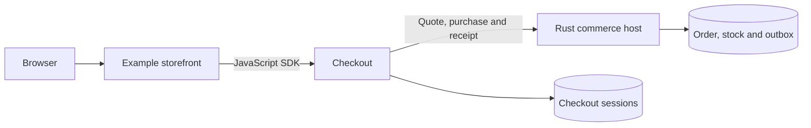

# Independent checkout service

The local reference storefront completes a simulated purchase through the
independent Checkout service and a separate commerce host. The
[component plan](commerce-components.md#checkout-independent-service-and-ui)
tracks the shared embeddable UI, provider coverage and hosted acceptance.

Checkout has its own target repository `veyndo/checkout`, Rust service, HTTP API,
MCP tools, JavaScript/TypeScript client and embeddable checkout UI. It must run
without starting the complete Veyndo product or reading private Core tables.
It must also compose into native Veyndo, Storyfront and external frontends.

## Domain ownership

Checkout owns versioned checkout sessions, cart/quote orchestration, progress and
customer-facing purchase/recovery state. It consumes explicit ports for catalog,
pricing/tax/promotions, inventory/reservations, customer/company policy, delivery,
orders/documents, legal context and Payments. These ports may target independently
released Veyndo components or another admitted backend. “Standalone” means usable
without the whole product, not a checkout that invents catalog, stock or prices.

Keep one owner of every financial/stock/order decision. Checkout must not create a
parallel pricing engine, payment ledger, order writer or unreliable browser queue.
Existing currency/minor-unit, language/country, B2B approval, Rule/Flow, channel,
rights and package-hook behavior remain authoritative through their domain owners.

## Commit boundary

The existing native purchase commits order, stock and outbox atomically. Splitting
a process does not turn this into an atomic transaction across unrelated databases.
Define one `CommitOrder` port whose domain owner retains those writes and replay
receipt in one transaction. In the composed product that remains the existing
commerce owner until its equivalent component is accepted.

External catalog, inventory and order integrations need explicit reservation
leases, expiry, idempotency, confirmed outcomes and recovery wherever those
operations cross transactional owners.

Checkout may store its own sessions and frozen quote references. Payment intents,
provider receipts, captures and refunds stay with Payments. Uncertain provider
outcomes are persisted/fenced and recovered; they are never blindly retried.
Expected cart/quote versions and current channel/customer/company authority must
be rechecked at purchase, not inferred from an earlier UI preview or model output.

## A purchase with a separate commerce host

The local reference uses two Rust processes and two PostgreSQL databases. The
Checkout service keeps the buyer's draft. The reference host supplies current
buyer and cart admission, an exact price in minor units, and one commit for the
stock decrement, order and outbox event. The same Rust purchase orchestrator
also runs in the Veyndo composition. A host can supply its own rules through
the orchestrator's required ports.

| Host operation | What it returns |
| --- | --- |
| `POST /store-api/checkout/session-quote` | Current amount, revision, channel and review policy for the buyer's cart. |
| `POST /store-api/checkout/session-order` | A receipt after explicitly reviewed confirmation. An exact replay returns that same receipt. |
| `POST /store-api/checkout/session-receipt` | The original receipt for the current buyer and checkout session. The cart credential is unnecessary here. |

The test reads the quote through HTTP and MCP, rejects a changed amount and
then sends two confirmed purchases for the last unit. It drops the successful
response after commit. After both processes restart, the JavaScript SDK reads
the same receipt. One stock decrement, one order and one event remain in
PostgreSQL. A revoked buyer can no longer retrieve the receipt.

## External reference storefront

The browser calls its own shop server. The server uses the [JavaScript SDK](https://github.com/veyndo/sdk)
to contact Checkout and keeps the buyer credentials on the server. A signed,
short-lived approval carries the exact price and revision the buyer reviewed.
Checkout uses the independent Rust host for current pricing and the final commit.

The browser test reviewed the 25 EUR cart and confirmed once. After the
response was dropped, the shopper recovered the original receipt and returned
to an empty cart. Reload recovered the same receipt. Desktop and mobile
layouts were checked in Chromium. Restarting all three processes also
preserved the original receipt, with one stock decrement, one order and one
event in PostgreSQL. A changed quote and an altered approval were rejected
before an order was written.

The sample uses a single synthetic buyer and one disposable cart on loopback.
The [Checkout repository setup guide](https://github.com/veyndo/checkout/pull/2)
is available to repository collaborators. Public shop and Storyfront buyers
continue to use the integrated commerce paths.

The existing Veyndo composition also passed local purchase, capture and refund
with PayPal and Shopware Payments fixtures. Under concurrent catalogue reads,
both paths completed 192 quote requests without errors. The local p95 was
43.7 ms through Core and 47.3 ms through Checkout. This run used local
PostgreSQL, synthetic identities and the same cart and quote on both paths.
[Measurement method](evidence/checkout-composition-performance-2026-11-08.md).

## UI and agent integration

Export the same cart, address, delivery, payment, review and completion controls as
an independent application and an embeddable UI. An external frontend supplies
its theme and admitted cart context through the shared UI host; Veyndo and the
original Storyfront use that same API/UI implementation. Provider-specific hosted
fields, wallets, required redirects and authentication remain supported by their
actual provider adapters.

An embedded checkout confirms completion only after authoritative server order
state. Return navigation and clearing the originating cart use a verified session/
order receipt and scoped message handshake. A browser message or URL fragment
alone never proves purchase. Support native and embedded return, refresh/restart,
expired carts, repeated callbacks and a stale original cart without duplicate orders.

The [hosted release checklist](storyfront.md#accept-a-hosted-release) verifies the
existing Storyfront path before and after the Core update. The
[Storyfront recovery contract](storyfront.md#responsibilities-and-contracts) lets the parent find
the original cart when a browser notification is lost. Status reads use the last
committed state without locking the cart. Only an explicit reopen takes the same
cart lock as purchase and rechecks the recovery key before replacing a transfer.
This keeps frequent status reads out of the order write path.

The agent may configure checkout, explain totals, obtain missing data and prepare
an action or validated interface. Deterministic controls remain usable when the
model is unavailable. Purchase, saved-method consent and financial changes need
their actual current user approval and backend checks. Agent-produced totals and
payment status are never authoritative.

## Required acceptance

- Its own image/configuration/session store, HTTP/MCP contracts and SDK examples.
- Independent external frontend example and actual Veyndo/Storyfront composition.
- Identical domain validation and replay semantics across HTTP, MCP and UI.
- Own/foreign shop/customer/channel/cart cases, paused/private shops, revoked
  rights, stale versions and B2B budget/approval changes.
- Concurrent purchase, stock contention, recalculation, legal/version receipts,
  outbox/Flow and document behavior without a second order/stock writer.
- Payment approval/cancellation/unknown outcome, supported methods, callback
  authentication, return, empty originating cart and refund integration.
- Real reference adapter/database/provider fixtures for automatic tests; configured
  provider acceptance remains distinct from fixtures and simulated payments.
- Controlled migration of existing routes, cart capabilities, pending payment
  attempts and receipts, with rollback. Do not invalidate active carts at cutover.

This component uses [the common agentic UI contract](agentic-component-ui.md).
