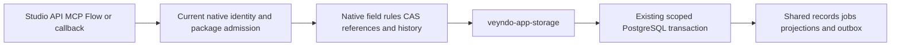

# App storage component: 5 November 2026

## Delivered boundary

[`veyndo/apps`](https://github.com/veyndo/apps) now owns the independently buildable
Rust package [`veyndo-app-storage` 0.1.0](https://github.com/veyndo/apps/releases/tag/v0.1.0). Its reviewed source is imported into the
complete Veyndo workspace at `extensions/services/app-storage/`; the exact commit
and all file hashes are in `components.lock.json`. Initial extracted native source:
`513721666e2d5118771611ee227e3618dc957e41`. Current package commit:
`8b04beb7e8ea3f615d37d46a1bd3cd3fe4a2fdfd`. Its original history, license and
`PROVENANCE.json` are retained.

The package has explicit connection, transaction and scope ports. It contains the
original fixed-table record SQL, job enqueue fingerprint/quota checks, transactional
outbox handoff, scoped job reads, single-winner claim and fenced progress update.
It has no dependency on Core, merchant/customer identity tables, inference,
provider clients or environment configuration. It opens no pool and never commits
on behalf of its caller.

The complete platform uses these functions on the existing native execution path:



`Scope` and `RecordKey` describe already-admitted storage keys. They are not
credentials. The library is trusted host code, never a plugin database interface.
The no-SQL Wasm crate `veyndo-apps` remains separate. Dependency controls reject
Core/network imports into storage and storage imports into guest/commerce crates.

## Independent PostgreSQL acceptance

The package test runs against a new empty PostgreSQL 17 database with no Core
process, commerce schema, identity schema or provider. `tests/schema.sql` is a
minimum fixture schema, not a supported production app schema. The ignored test
must be explicitly invoked with `APP_STORAGE_TEST_DATABASE_URL`.

Observed locally with the exact package commit above:

- Equal record IDs remain distinct across tenants and apps. A fifth-language value
  and an explicit null survive storage. Record rollback and scoped preview cleanup
  preserve other apps and tenants.
- Job and outbox commit together. Explicit transaction rollback and a forced outbox
  insert failure both leave no job behind.
- Concurrent identical requests create one job and return the same ID. A changed
  payload under the same key conflicts. Active-job limits reject the eleventh job.
- A claim has one winner. Foreign scope, wrong lease, decreasing progress, expired
  lease and success after requested cancellation are rejected. Expired jobs are
  not automatically reclaimed.
- A new pool after connection shutdown reads the persisted job and lease. This
  checks reconnect durability, not database disaster recovery.

Commands:

```sh
cargo fmt --check
cargo clippy --locked --all-targets -- -D warnings
APP_STORAGE_TEST_DATABASE_URL=postgres://.../empty_test_database \
  cargo test --locked --test postgres -- --ignored --nocapture
```

The component has its own PostgreSQL CI:
[run 42044222035](https://github.com/veyndo/apps/actions/runs/42044222035).
`main` requires its `storage` check, including for administrators, and disallows
force pushes and deletion.

## Assembled Veyndo acceptance

A freshly built Core uses the extracted crate with the existing native PostgreSQL
schema. The targeted suites passed locally:

| Check | Observed effect |
| --- | --- |
| `app_shared_storage` | Eight shops with four app installations each create no per-app physical tables/indexes; typed values, unique-write races, projection write denial and actor-private cleanup retain their guards. |
| `app_jobs` | Native API idempotency, cancellation, uncertainty, current creator rights, quotas and CAS pass. Completion evidence and record updates commit together; stale revisions and revoked creators cannot complete the job. |
| `tenant_isolation` | 43 checks pass, including HTTP/MCP foreign scope denial, composite foreign keys and app RLS pool reuse under a non-superuser/non-bypass role. |
| Marketplace PostgreSQL fixture | Independent service HTTP/MCP record/sync calls reach native durable jobs; Amazon/eBay/Kaufland local fixtures exercise listings and localized overrides. Native paid-order intake, replay, once-only stock, Flow side effect, invoice/PDF, service restart and foreign-tenant denial pass. |

These checks use isolated synthetic tenants and local provider fixtures. The main
fixture connection is a test owner; the app RLS subtest explicitly switches to its
restricted role. This is not a new strict-runtime deployment or real-provider
purchase acceptance. No full daily suite was rerun for this change.

## Remaining work

MKT-03a is complete. MKT-03 and APP-02 remain open. The next steps are extracting
validated host operations and the identity adapter, supporting a production schema
and restricted role without Core, exposing that same owner through API/MCP/SDK,
then testing migration, restore and the pinned complete product. Native record
validation, projection maintenance, signed RLS, history, model migration and
publication are still owned by Core. No database migration, new role, production
restart or public checkout test is part of this extraction.
