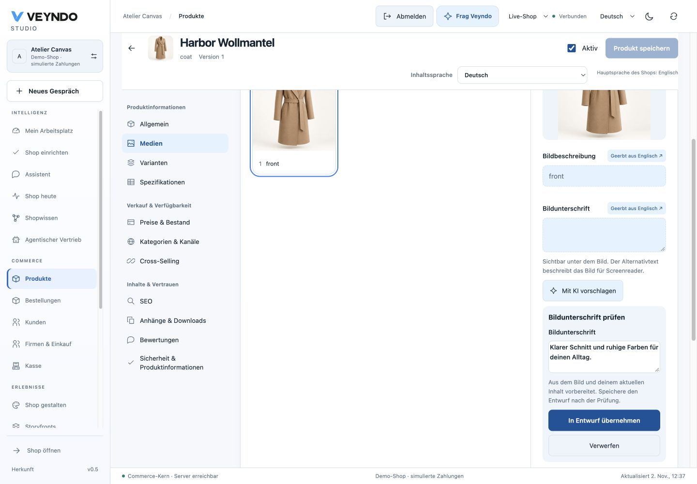
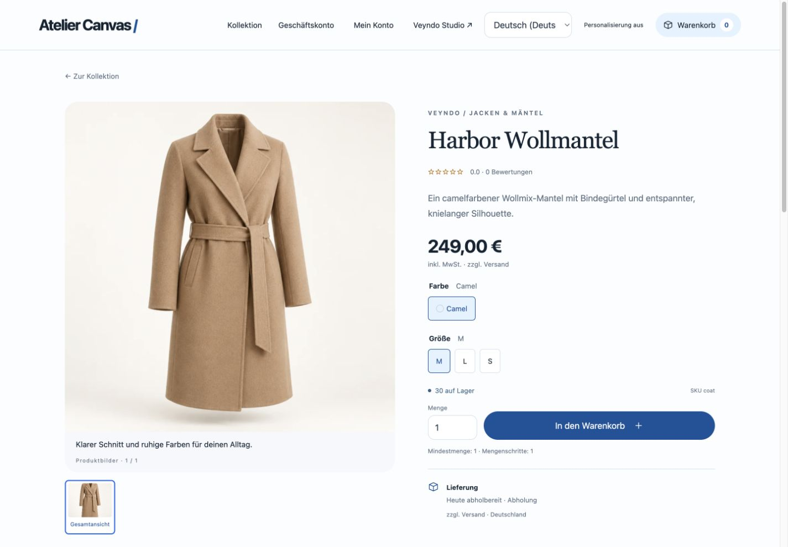

# Shared image captions: local acceptance, 2 November 2026

## Source and scope

Feature branch `feat/canvas-media-20261102` starts from main `d899fb87`. This adds
localized image captions to existing product/page/app owners and a reviewed native
AI proposal. It does not implement the proposed common zoomable Canvas or certify
an external model's visual/editorial quality. All model responses used below are
explicit synthetic local fixtures; no paid provider call was made.

## Observed checks

| Check | Evidence |
| --- | --- |
| Native image/text admission | Three Rust tests cover exact bundled image paths, safe bounded decoded thumbnails and rejection of markup/action-bearing/oversized proposals. |
| HTTP/MCP and storage | The real Rust/PostgreSQL visual workspace suite passed caption proposal parity, permission/unknown-locale rejection before inference, own private upload evidence, foreign-image denial, public-network egress restrictions, unchanged product state after proposals/provider failure, localized product persistence, null fallback and explicit blank text. |
| Revision and publication | The same suite saved page image metadata in the site-builder app, kept sandbox captions private and selectively published the changed record through the existing release owner. History remained available; stale revisions were rejected. Existing forms, design-reference proposals, coding-agent approval and app element publication checks also passed. |
| Shared UI | Nine new component tests cover reviewed adoption, fifth content locale, inherited/manual text, context-only labels, failures, six stale-response cases and product/page/app/rich-document figcaption rendering. Existing media workspace, native app, designer and product-content tests passed. |
| Browser | Chrome generated and reviewed a German caption using the local fixture, adopted it, saved through the native product editor, added an independent English caption, reloaded the product and displayed the saved German caption in the actual storefront. The bundled WebP provided image evidence. |
| Responsive storefront | Desktop 1440×1000 and mobile 390×844 captures show the real caption below the image; the mobile document did not overflow horizontally. |
| Structural checks | Native format/Clippy, TypeScript/Vite build, prompt manifest governance, generated HTTP/operation contracts, module ownership/size/localization and exact source inventory checks passed. Formal extraction/conformance and negative mutations retain their original proof boundary. |

The targeted component checks are separate from the scheduled daily full suite.
Provider fixtures prove protocol/admission behaviour, not real-model caption
accuracy or resistance to every semantic prompt injection. Public Core delivery
has not been established by these local checks.

The independent Impeccable finish review returned **ship** for the bounded
caption controls and storefront captions. The documenter confirmed reuse of the
incumbent system without inventing a new brand/design layer. Source detection
reported no findings in the four new UI files; it was a source scan, not an
automated contrast measurement. Desktop/mobile render inspection completed that
check. The larger pre-existing gallery layout and proposed Canvas remain outside
that caption review.

## Captures

[Mobile storefront](../assets/media-captions-20261102/storefront-mobile.jpg) ·
[Mobile proposal review](../assets/media-captions-20261102/proposal-mobile.jpg).

The images show a local synthetic shop with simulated commerce. The proposal
wording comes from a local test provider. The product photograph is an existing
bundled demo image, not a new image-generation result.

Subsequent shared Canvas work is recorded in [its own acceptance](canvas-workspace-2026-11-02.md). This earlier receipt retains its original caption-only scope.
