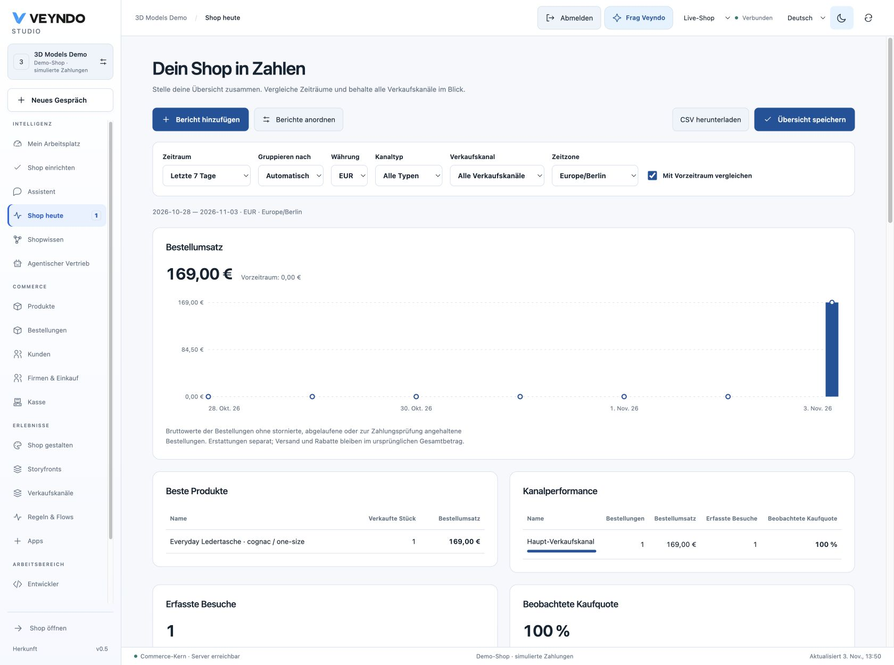
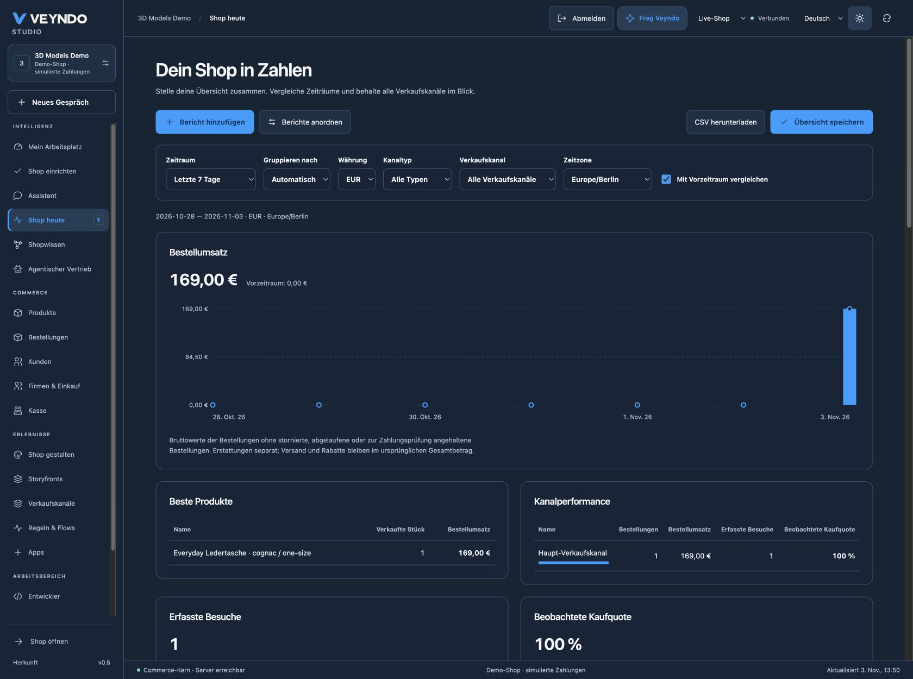

# Merchant reports acceptance, 3 November 2026

Feature Core `62deb4ec364c907e053a137b44b9d14e1da8ef8f` was built as
`main-scarecrow-1464` and deployed to the public Core. The new replica
`vendune-core-79c4d99795-6m786` reached 1/1 passing with zero restarts.
Presentation Core `598246a8d7872043ae8e0ed9bd0e951ede18669d`, image
`swell-mark-5354`, then reached 1/1 passing with zero restarts on
`vendune-core-857cb7655c-twqjv`. Public reload retained the reports and verified
actual native dark surface/text colors. The page recorded no console errors.

## Public native journey

In the synthetic **3D Models Demo** shop, a guest allowed only native shop
analytics, viewed a product, added one item, reviewed contact/address data and
completed the explicit simulated payment. Order **RAC-6f9b7eb2** was saved for
**EUR 169.00**. The original cart was empty. Native Studio confirmed the simulated
payment state through its existing order workflow.

The publicly delivered reporting surface then showed:

| Observation | Result |
| --- | --- |
| Ordered revenue | EUR 169.00 |
| Native orders | 1 |
| Top product | 1 unit, EUR 169.00 original line value |
| Main channel | 1 order, EUR 169.00 |
| Consented observed cart contexts | 1 |
| Matched converted contexts | 1, displayed as 100% |
| Product view, cart addition, checkout and conversion stages | 1 each |

The 100% is a synthetic single-context result, not measured business conversion.
The actual downloaded CSV retained the same exact day/product amounts and
consented purchase stages. Cards were added, reordered and switched to bars;
the saved seven-day Europe/Berlin overview survived reload. A separate yearly,
monthly-grouped personal workspace view also survived reload. Switching to the
existing private stage showed zero private revenue and a private environment
label, with no live order copied into the report. Unauthenticated public HTTP
returned 401. The reporting page recorded no browser console errors.

## Native and interface checks

The registered local `merchant_reports` suite performs actual native checkout and
cash-register sales before checking their aggregates. It checks consent withdrawal,
MCP/HTTP rights, a foreign tenant, private preference CAS and unknown-field rejection.
Additional isolated historical fixtures cover 150 days, cancellations, weekly and
monthly groups, separate JPY scale, marketplace/headless attribution, and a recorded
EUR 0.50 refund in both aggregate and time buckets. The refund fixture checks the
report projection; it does not claim an external provider refund transaction.

Four final reporting interface tests pass; the related 18-test interface group,
calendar bounds test, frontend build, localization, architecture, source/API
inventory, documentation hygiene and suite partition controls pass. Existing
formal extraction/conformance and mutation controls pass; the new reporting
SQL/adapters remain explicitly unproved. Local Chrome checks cover desktop,
390px layout, light/dark themes and persisted personal layouts.
