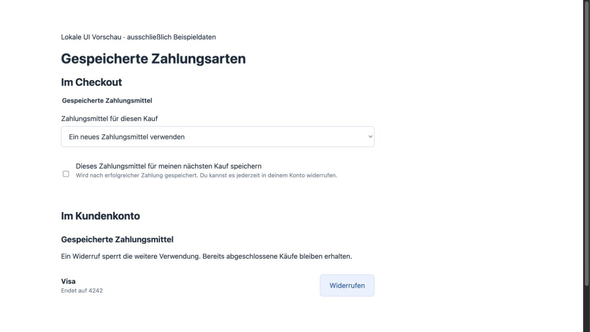
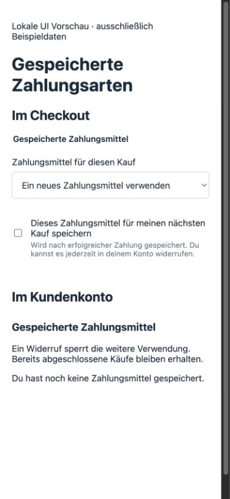

# Saved payment methods: local acceptance, 3 November 2026

Core PRs 284/285 and private provider PRs 14/15 are merged, contract 1.6.0.
Actual native Rust processes and disposable PostgreSQL use synthetic provider
HTTP. No provider account, external charge or hosted deployment is involved.

## Actual service path

- Registered customer saves with explicit consent and completes one purchase.
- Public HTTP/MCP lists only opaque IDs and redacted display fields. Private
  database bytes contain encrypted tokens, not the provider's plaintext token.
- A second own-account purchase uses the saved private token through the provider.
- A different customer, another shop, a guest and an owning cart without the
  current account credential cannot read or use it.
- Revocation is immediate, idempotent and durable; cleanup does not refund or
  alter the first purchase. Reuse is refused.
- Reusing a cached private operation key with changed customer consent is refused
  before provider traffic.
- A later invalid optional metadata response does not undo a confirmed capture.
  Delayed confirmation survives a private service restart. Signed reconciliation
  stores the handle, with exactly one capture POST.
- Distinct restricted SQL logins pass strict Core startup and own-account HTTP.
  Unsigned tenant/system settings, schema bypass and private token reads fail.
  The combined fixture separates private provider tables into its own schema for
  this final check; hosted services use separate databases.
- Independent private provisioning/grants tests pass with non-owner runtime and
  restart. The existing invoice/PDF/encrypted mail/Flow/recovery/refund selection
  also passes with the 1.6.0 service.

## UI and focused checks

Six component tests exercise unchecked consent, method selection, revocation,
error recovery, independent save progress and late responses after account switching. The actual components were rendered with synthetic
presentation data at desktop and 390 × 844. The mobile document has no horizontal
overflow; revocation displays the empty account state. These captures show a
component fixture, not a new public checkout acceptance.

[Mobile save-progress messages, local component fixture](../assets/payment-vault/notice-mobile.png).

Private Rust checks cover encryption randomization, binding and tamper rejection,
equivalent hex/base64 encryption keys and rejection of malformed key input. The
native redaction unit rejects hidden provider/customer data
and malformed display metadata. Frontend build, localization, architecture and
the manual design detector are targeted checks. Full tests and coverage retain
the existing daily/manual schedule.

## Remaining acceptance

The hosted-mode simulation transport was run locally against actual native Core
and private Rust services. It passed PayPal/card save and repeat purchase,
own-account revocation and original purchase refund with zero external HTTP calls.
The exact additive 003/004 maintenance SQL was separately
applied to a local 001/002 database and replayed successfully, retaining checksums
and restricted runtime grants. These preparations do not establish hosted rollout.

Apply native migration 110/private 003/004 and private runtime grants, configure
the private encryption key and roll out the matching artifacts before hosted
acceptance. Actual provider tests remain deferred by the owner. This scope does
not accept merchant-initiated recurring/subscription charges or PSP token deletion.
