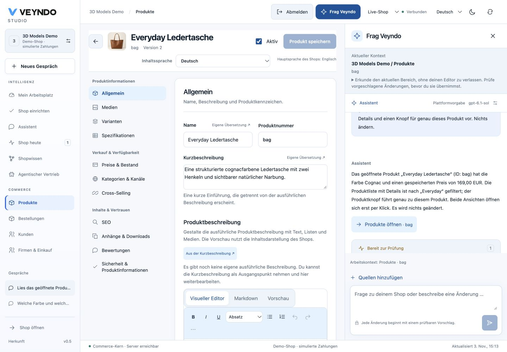
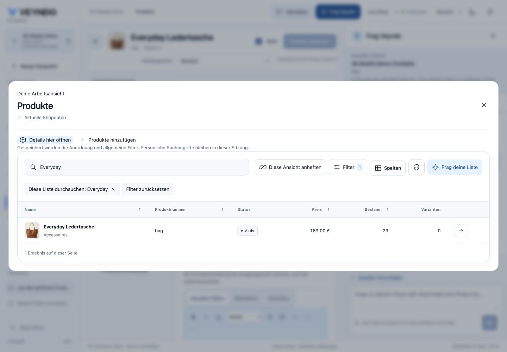

# Persistent contextual assistant: 3 November 2026

Source: PR 278, `99d11901b729c012fcee43b626fd2626e982987e`.

The Studio header opens Ask Veyndo beside the current native editor. Conversation,
run progress, proposals and source tools reuse their original owners. Hiding the
sidebar does not unmount the editor or save its draft. Current view, selected
native entity and mounted app accompany each submitted turn as presentation hints.
Navigation suggestions accept registered views only and bind current domain/PII
rights and own-tenant record existence. Opening is explicit.

OpenUI 1.0.1 renders host-compiled model component choices from the existing typed
working-view contract. It binds the actual native directory, details editor and
catalogue intake. Arbitrary model markup, queries, rows and authorization do not
reach the renderer. Patched Zod 4.6.7 is used; production dependency audit is clean.

Local acceptance:

- 20 affected UI tests plus the final focused 10-test rerun after error placement;
  eight Rust agent-run units and 52 native HTTP/provider checks pass.
- Own/real-foreign product references, malformed targets, URL/script injection,
  domain and PII denial, scope changes and composition validation are covered.
- Native lint, structure, four-language catalogues, prompt provenance/immutable
  prior revisions, site/link checks and the existing 184 formal negative policies
  pass. SQL, inference and rendering remain reviewed unproved adapters.
- Actual local Qwen 3.6 read the selected bag, answered Cognac and EUR 169, proposed
  a native working view and opened the genuine embedded product editor.
- Existing conversation reopened in the sidebar. An unsaved product-number edit
  survived collapse/reopen and was reset without saving. Native navigation opened
  the proposed product list with the conversation still present.
- Chrome desktop 1440 × 1000 and phone 390 × 844 show no document overflow. The
  phone Send control is 44 × 44. Dark mode native action text and the generated
  work surface use the actual Studio theme tokens.

The daily complete suite cadence is unchanged. These checks concern the new
assistant presentation/navigation/composition path; they are not a fresh checkout
or real-provider financial acceptance.

## Public rollout and model answer

Northflank image `enigmatic-ice-2822` completed successfully. The Core deployment
`vendune-core-5689fcd96f-7pnk7` serves source `99d11901` with one passing replica
and zero restarts. The existing public personal merchant session opens the fixed
right sidebar on `app.veyndo.ai`; the selected native product is `bag`.

The configured public model, `gpt-6.1-sol`, read the actual product and answered
cognac and EUR 169. Its navigation button correctly bound product `bag`, but the first working-view
proposal incorrectly selected `orders` despite announcing products. The browser
exposed that mismatch; this was a failed working-view acceptance, with no product
mutation. The follow-up makes the model choose one explicit entity, validates
linked navigation/view consistency server-side and blocks mismatched saved views
in the client. The actual native target is shown before opening. Local Qwen and this public provider are
separate observed model runs; synthetic provider checks remain labelled above.

## Corrected public acceptance

PR 279, source `6442279d28786a6422419bd2e0ec13cac7bcebe0`, is publicly
serving after successful image `numerous-boat-4033`. The new Core pod
`vendune-core-84dd4584c5-gpxlk` passed 1/1 checks with zero restarts.

The same public merchant session verified the following after that pod became
ready, on 3 November 2026 at 15:13 Europe/Berlin:

- Reopening the earlier inconsistent proposal shows its actual **Orders** target
  and a localized explanation. It no longer offers the working-view action.
- A fresh `gpt-6.1-sol` conversation reads selected product `bag` and answers
  **Cognac / EUR 169.00**. It prepares **Products**, filtered by `Everyday`, and
  a distinct **Open Products · bag** action.
- Opening the generated view displays the genuine native product grid with one
  matching row, product number `bag`, EUR 169.00 and its current stock.
- Selecting that row opens the genuine product editor inside the view, showing
  **Everyday Ledertasche**, **bag**, **Version 2**, with Save disabled.
- Closing the working view, returning to the normal directory and using the
  assistant's exact-product button reopens `bag`. The conversation and right
  sidebar remain present. No product or other commerce mutation was submitted.

Final focused validation covers **21 UI tests**, **nine Rust agent-run tests**
and **52 native HTTP/provider checks**, including the observed mismatch. These
replace the earlier local counts for the final source; the first public negative
above remains part of the record. Native lint/build, prompt governance, four
languages, structure, site links and the scoped visual detector pass. Full daily
tests keep their existing cadence.

