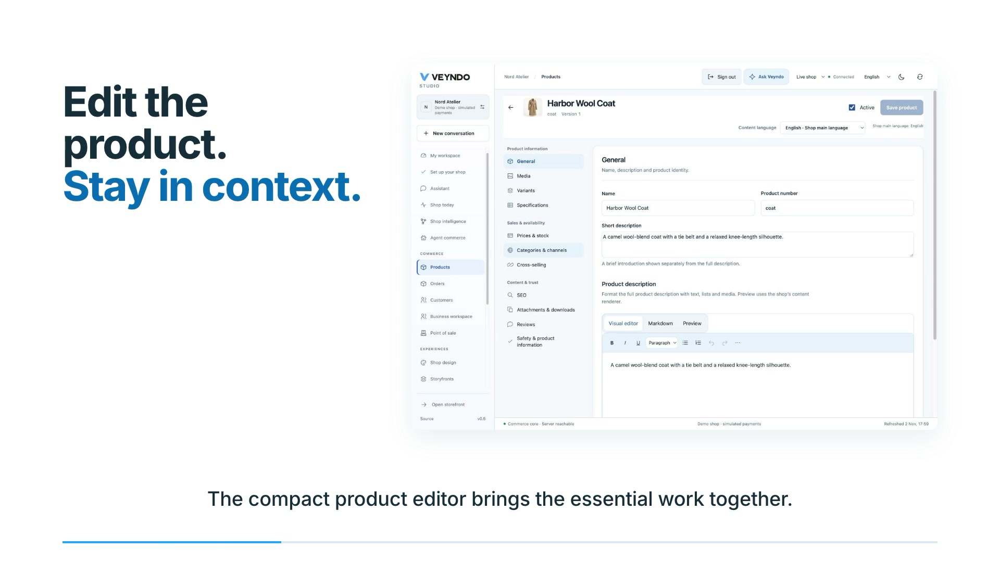

# Your first Veyndo Commerce round: change, review, publish

Explore one connected workflow before reading the complete feature list. This is
a working prototype; use synthetic data and simulated payments.

## Watch without an account

[Watch the 1:56 AI commerce overview](assets/showcase/product-films-20261102/veyndo-ai-commerce.mp4)
with [English captions](assets/showcase/product-films-20261102/veyndo-ai-commerce.en.vtt).
It introduces the agent workspace, visual design and app platform with actual UI
captures, synthetic data and simulated payments. The films have subtitles and no sound.
[All product films and capture notes](video-tours.md).

[](video-tours.md)

## Run your own local tour

The container path needs Git, Docker with Compose and OpenSSL. It does not require
Rust, Node, Python, a model download or provider credentials.

```sh
git clone --depth 1 https://github.com/veyndo/veyndo.git
cd veyndo
./scripts/try.sh
```

Open **http://127.0.0.1:8788/**, then **Studio → Create shop**. Create a personal
local owner account and a separate synthetic shop. No account or registration on
veyndo.ai is needed. Your local data stays in the Compose project's named volume.

The published image targets **Linux amd64**. ARM hosts need Docker's x86 emulation;
native ARM packaging and its acceptance are not claimed. If the public image is
not available, [build from source](quickstart.md). The first pull may take time.
Choose another local port/project without touching other development shops:

```sh
TRY_PORT=8789 TRY_PROJECT=veyndo-my-tour ./scripts/try.sh
```

## Set up your own shop

The optional **Set up your shop** entry in Studio offers six review areas, an
inline company form and a saved return point. It links to the existing catalogue,
design, checkout, legal and test tools. [Illustrated setup guide and current local acceptance](shop-setup.md).

## Complete the round

1. In the shop's storefront, choose a coat size and place one **simulated** order.
   Inspect that saved order in Studio. This exercises the existing commerce path.
2. In Studio's environment controls, create a **sandbox** from your synthetic shop
   and switch into it. Check the displayed environment before editing.
3. Open a product and change its description to a clearly fictional tour note.
   Save it in the sandbox. The live product must still have its original description.
4. Open **Review changes**. Select that product change only, inspect it against
   the live baseline, then explicitly publish the selected change.
5. Return to the live product and verify the description. Live inventory is
   preserved by content publication. A concurrent live edit should cause a conflict,
   rather than being silently overwritten.

This first round works without an LLM. After [configuring a model](connectors.md),
you can ask for a bounded product proposal and inspect its fields before approval.
Model configuration or a generated summary alone does not prove a completed action.

## Let fictional customers test the private change

After [configuring a model](connectors.md), stay in the full private sandbox and
open **Shop knowledge → Customer simulator**, or **Shop design → Test with
customers**. Describe one shopping goal, edit the customer budgets and run the
test. Inspect the saved native observations and test orders. Change one private
setting, choose **Use these customers again**, and compare the two runs before
selecting a release. [Illustrated simulator guide and evidence](customer-scenarios.md).

A public shopper can separately ask for a gift or comparison, edit the visual
product selection and use the ordinary product options and checkout.
[Visual shopping guide](ui-experience.md#standard-storefront-and-customer-account).

## Stop, return and share what happened

```sh
./scripts/try.sh stop
./scripts/try.sh
```

Reuse the same `TRY_PORT` and `TRY_PROJECT` values if you changed them. Stopping
does not delete orders or accounts. Do not remove the data volume if you need them.
The preview tag moves; use `VEYNDO_IMAGE=ghcr.io/veyndo/veyndo:sha-COMMIT_SHA`
with an actual published full commit SHA when you need an exact source version.
Choose that SHA from a successful **Publish tested local preview image** run.
Documentation-only commits do not create another image. A manual **Run workflow**
on main can rebuild intentionally; a documentation commit landing during a build
does not prevent the tested runtime from advancing the preview tag.

[Tell us where you got stuck or what you built](https://github.com/veyndo/veyndo/discussions)
or [report a reproducible bug](https://github.com/veyndo/veyndo/issues/new/choose).
Include your source/image version, operating system and the first unexpected step.
Keep credentials and customer data out of public reports.

[Sandbox boundaries](workbench.md) · [Build useful apps](app-studio.md)
· [Connect an agent](agent-workshop.md) · [First contributions](early-contributors.md)
