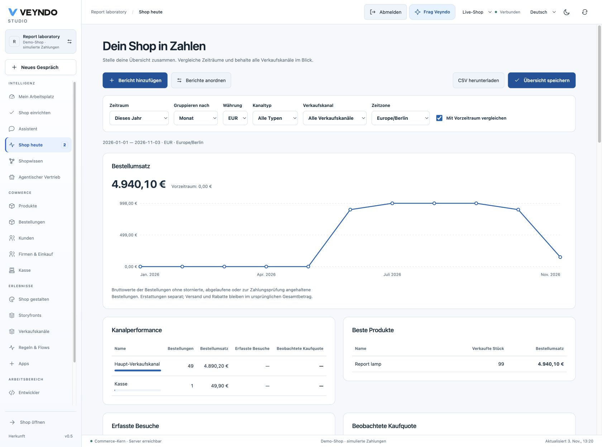
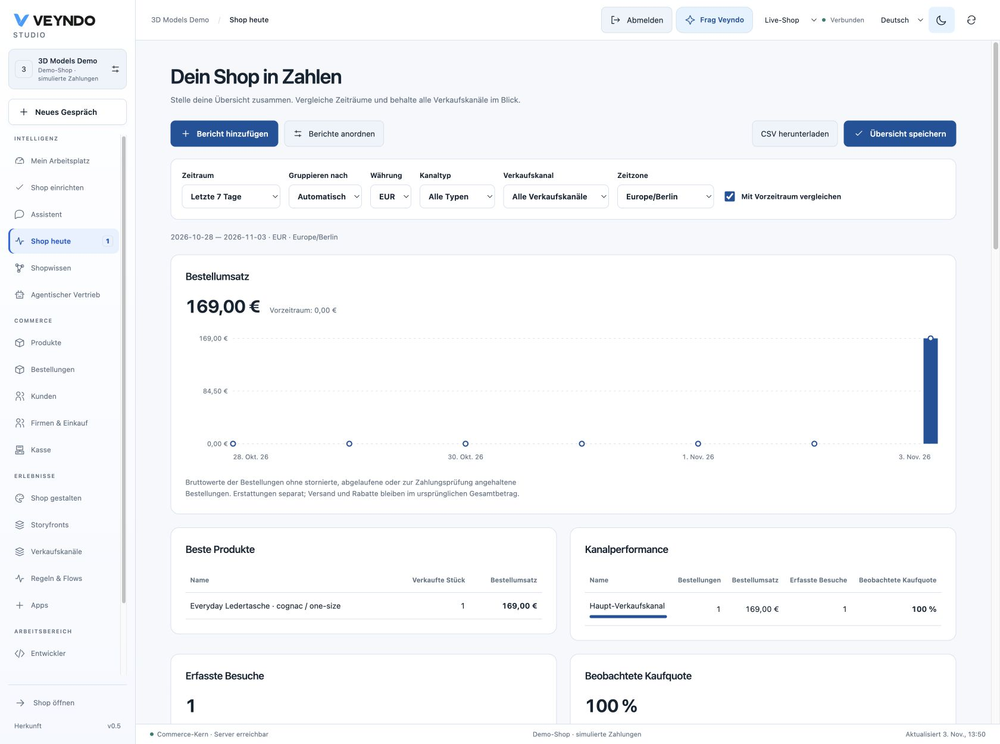

# Your shop, in numbers

In **Shop today**, build a reporting overview for the questions you ask most often.
Use the same reports in each area of **My workspace**, alongside your pinned views,
work cards and agent suggestions.

## Build your overview

1. Open **Shop today** and choose a period. Today, week, month, year, all time and
   custom dates use the selected timezone. The end date is inclusive.
2. Choose daily, weekly, monthly or yearly grouping. **Automatic** chooses a
   readable grouping. Compare with the immediately preceding period of equal length.
3. Select a currency, channel type or individual sales channel. Online shops,
   headless channels, marketplaces and the register share the same native orders.
4. Click **Add report** and choose the reports you need.
5. Click **Arrange reports**. Drag cards to their new position, or use their arrow
   controls. Choose line, bars or table and half or full width. Remove cards here.
6. Click **Save overview**. These choices belong to your personal account in this
   shop. Other team members retain their own overview.

For a separate reporting workspace, open **My workspace**, select or create an
area and use **Add report** there. Save with the existing workspace save action.
Each area can have its own filters and arrangement. Existing workspace revision
history and conflict handling apply to both kinds of overview.

## Available reports

| Report | Meaning |
| --- | --- |
| Ordered revenue | Original gross order totals, including original shipping and discounts |
| Orders | Number of eligible native orders |
| Average order | Ordered revenue divided by eligible orders |
| Refunds | Current recorded refunds on orders placed in the selected period |
| Best products | Top 20 products by original line gross value, with quantities |
| Channel performance | Top 100 channels by ordered revenue, order counts, observed visits and conversion where permitted |
| Observed visits | Distinct native cart contexts with current analytics consent |
| Observed conversion | Observed contexts matched to an eligible order in the selected currency, divided by observed contexts |
| Purchase journey | Observed contexts at visit, product view, cart addition, checkout and converted order |

The journey counts contexts that reached each step independently. It is not a
strict sequence analysis. Repeated events from one context do not create new
visitors. Missing visitor history appears as unavailable, rather than invented
zeroes. Changing or withdrawing consent changes which observations remain eligible.

## Read the numbers correctly

**Order value and settlement are different measures.** Cancelled, expired,
payment review and failed payment orders are excluded. Other recorded orders can
include pending payment. Simulated order counts are explicitly identified.
Refunds are a current total on the selected order cohort, not a history of refund
transactions by refund date. Product rankings use line value, so their sum need
not equal order totals with shipping and cart discounts.

**Currencies stay separate.** The report sums exact decimal snapshots from native
minor units, with legacy numeric snapshots as fallback. Select EUR, JPY or another
recorded currency; amounts are never silently converted or added across currencies.
Display uses the recorded currency scale. CSV retains decimal strings.

**Traffic follows the existing privacy policy.** Native analytics uses its existing
channel policy, consent receipt and retention limit of 1 to 30 days. These reports
add no tracking store or retention extension. Annual sales can be reported from
retained orders; annual visitor history cannot be reconstructed from expired events.
POS orders count as sales and do not imply browser visits. Channel performance
uses the channel associated with the original cart or order.

## Connected implementation

`POST /api/merchant/reports` and the registered agent/MCP operation
`merchant.reports.read` call the same Rust reporting owner. Period, grouping,
timezone, currency, channel and comparison are typed inputs. The response contains
bounded aggregate totals, trend buckets, product/channel rankings and optional
consent eligible visitor aggregates. No customer records are returned.

`overview.read` or `orders.read` admits the aggregate report. Product rankings
additionally require `catalog.read`; visitor projections require `knowledge.read`.
Channel names require `channels.read`; otherwise the response contains channel IDs.
Current rights are checked on every request. The interface discards cached reports
when shop, filters or rights change. Export uses that same authorized snapshot,
with spreadsheet formula escaping for merchant supplied labels.

Private stages report their own orders and are visibly labelled. Layouts remain
personal workspace preferences in the live shop, not publishable shop configuration.
They contain filters and card choices, never report rows or authority. Up to 12
cards and 400 time buckets keep the interface bounded. Large date ranges need
coarser grouping. Queries use the tenant/time order index and PostgreSQL numeric
aggregation. This is an operational report, not a new warehouse or measured
large merchant performance guarantee.

## Acceptance

The native `merchant_reports` suite creates isolated local shops, performs a real
native simulated checkout and cashier sale, and verifies exact totals, consent
withdrawal, per-channel conversion, HTTP/MCP permissions, tenant isolation,
workspace persistence and revision conflicts. Synthetic historical fixtures cover
150 days, weekly/monthly grouping, cancellations, zero-decimal money and marketplace/
headless attribution. These attribution fixtures do not contact marketplace providers.

Targeted interface checks cover composing and reordering cards, changed filters,
late responses after shop/permission changes and CSV escaping. The public native simulated EUR 169.00 purchase, matching reports, saved layouts,
actual CSV download and private stage separation passed on 3 November.
[Observed public journey](evidence/merchant-reports-2026-11-03.md) and
[current status](status.md) retain exact delivery scope. Screenshots show
labelled synthetic demonstration data.
