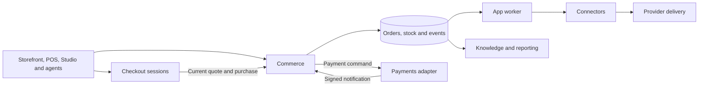

# One shop, composable parts

Run Veyndo as a complete shop, or start with the capability you need. A retailer can use its storefront, POS and merchant Studio together. A developer can integrate a marketplace gateway, run app logic or use the SDK with an existing commerce system.

Studio can compose the normal Orders view with shipping policy from Shop
Knowledge. An external host can combine the corresponding Commerce and
Knowledge reads through the same SDK layout contract.
[Walkthrough and runnable example](agentic-component-ui.md#orders-shipments-and-shipping-policy).

Installed apps can place interactive results in both Veyndo conversations.
The chat host mediates calls to the app's existing operation. A shopper can
review a variant's price and delivery before adding it to the cart. A merchant
can review and apply a saved catalogue proposal from the same conversation.
App cards in the shop and Studio can appear as their data becomes available,
while the assistant prepares its reply. Both conversations can carry an applied
filter into an editable follow-up. Commerce checks the current shop context
and owns the resulting changes.
[MCP Apps and OpenUI](agentic-component-ui.md#one-capability-two-ways-to-present-it).
[Build and connect the Product Guide](product-guide-mcp-app.md) for a complete
example with public care cards, private merchant notes, interactive filters and
JavaScript tool discovery from the independently released Apps model.

## How one shop works

Commerce owns the catalogue, prices, stock and orders. Checkout coordinates the buyer's session and asks that owner for the current quote and the purchase. Commerce checks current purchasing authority and commits the order, stock allocation and event in one transaction. [Company and shop authority tests](checkout-component.md#current-buyer-channel-and-company-authority). The receipt can be read independently of the original purchase request.

### Read the catalog from JavaScript

Install the [SDK 0.4.3 package](https://github.com/veyndo/sdk/releases/tag/v0.4.3).
An external storefront can read the same public catalog as the hosted shop.
This example uses the German content of the public Lumen demo.

```js
import { createCatalogClient } from '@veyndo/sdk/catalog';

const catalog = createCatalogClient({
  baseUrl: 'https://app.veyndo.ai',
  shop: 'lumen-story-lab-15-o-98aa4751fa',
  locale: 'de-DE',
});
const first = await catalog.list({ limit: 1 });
const product = first.elements[0];
if (product) {
  const detail = await catalog.detail(product.id, { limit: 1 });
  console.log(detail.product.name, detail.currencyContext.code);
}
if (first.nextCursor) {
  const next = await catalog.list({ limit: 1, after: first.nextCursor });
  console.log(next.elements[0]?.name);
}
```

Use `detail.variantsPagination.nextCursor` to continue a variant family.
The selected SKU and visible parent can repeat, so combine pages by product
ID. Keep the same shop, channel, language, currency and filters between pages.
Commerce supplies the displayed price and delivery estimate. Checkout uses
the current quote at purchase.
[Runnable example](https://github.com/veyndo/sdk/blob/v0.4.3/examples/store-catalog.mjs).

### Run the browser example

In a Node 22 or newer project, install the release archive and start the
included host.

```sh
npm install https://github.com/veyndo/sdk/releases/download/v0.4.3/veyndo-sdk-0.4.3.tgz
node node_modules/@veyndo/sdk/examples/browser.mjs
```

Open the printed loopback address. The example loads the public Lumen
catalog. Select **Load more products** to follow the next page, or search
for `Tischleuchte` and open the result to see the current price and stock.
The same package contains a command line version at
`node_modules/@veyndo/sdk/examples/store-catalog.mjs`.

The browser calls its local Node host. The host uses the SDK to read the
configured Store API, so the browser needs no shop credentials or cross
origin access. The host uses Node's standard library and binds to loopback.
Set `VEYNDO_URL`, `VEYNDO_SHOP` and `VEYNDO_LOCALE` before starting it to
use another public catalog.
[Example source](https://github.com/veyndo/sdk/blob/v0.4.3/examples/browser.mjs).

### Connect checkout

JavaScript and TypeScript clients can create a draft, submit a reviewed
purchase and check the original receipt with the typed Checkout SDK.
[Prepare and review a cart](checkout-component.md#review-a-cart-change-from-the-sdk).
[Choose shipping and payment](checkout-component.md#choose-shipping-and-payment-from-the-sdk).
[Use the Core relay](checkout-component.md#use-the-checkout-relay-from-the-sdk).
[Use the shop's browser session](merchant-operations.md#use-the-signed-in-browser-with-the-sdk) ·
[Manage buyer profiles and addresses](merchant-operations.md#edit-the-buyer-profile-with-the-sdk) ·
[Read orders and download a receipt](merchant-operations.md#read-order-history-with-the-sdk) ·
[Download purchased files](merchant-operations.md#download-purchased-files-with-the-sdk).

Core supplies checkout to both the native storefront and Storyfront. In the
public Lumen test shop, both browser routes completed a PayPal Sandbox capture
through the private Checkout service and returned to an empty cart. Both use
the same Commerce owner for quote, commit and receipt. Studio refunded both
Sandbox captures. A separate demo order generated an invoice through the app
worker. The hosted mail delivery test still needs a sender and transport.
[Live pilot and verification](checkout-component.md#hosted-lumen-pilot-10-november-2026).
[Current shared Cart rollout and public demo purchase](status.md#shared-cart-contract-on-northflank).
[Reproduce purchase recovery and compare the isolated Northflank runs](evidence/composed-release-rehearsal-2026-11-10.md#northflank-rehearsal-with-deployed-executables).

The original Core and App Worker images also passed native purchase and
invoice recovery as separate hosted services with restricted system and
tenant database roles. [Hosted startup and isolation checks](evidence/composed-release-rehearsal-2026-11-10.md#run-the-original-images-with-restricted-database-roles).

Five separately hosted workloads now passed a private Northflank rehearsal.
Independent Checkout recovered a demo purchase after a restart. A native
purchase exercised the separate Payments simulator, signed callback,
app worker, invoice, Connector, SMTP receiver and refund. The two tests
shared the same Core with signed database scope. Core owned each order
and stock movement. [Builds and results](evidence/composed-release-rehearsal-2026-11-10.md#run-five-separate-workloads-on-northflank).

A paired Northflank run then measured the cost of forwarding confirmations to
Checkout while Core served catalogue reads. A bounded wait before forwarding
reduced confirmation p95 from 2.99 s to 1.07 s. Both settings produced one
order, stock movement, invoice and test mail per purchase. Core kept the same
transaction boundary and limits for checkout and its callbacks.
[Load and recovery evidence](evidence/composed-release-rehearsal-2026-11-10.md#compare-confirmation-waits-across-separate-services).

The storefront and Studio use that same shop identity and transaction boundary. Provider calls run through durable jobs. Knowledge and reporting can be rebuilt from their sources. They add context and visibility without joining the purchase transaction. Agents use the same admitted operations as the team and prepare changes for review where approval is required.



## Choose a starting point

For Rust integrations, the [Commerce crate guide](../crates/commerce/README.md)
shows shared product, cart, contact and address contracts. Its contact example
runs without a server. The host still owns account identity, PII admission and
the atomic order transaction. Independent HTTP/MCP hosting for the remaining
Commerce domains is tracked in CORE-02..10.

The four public development repositories are linked below. The other links explain the component's contract and its place in the complete shop. Some have separate builds or access-controlled source, and some are still domains in the product repository. The [implementation plan](commerce-components.md) tracks each extraction and the [current status](status.md) records what has been released and tested.

The same release checker prepares a pinned update for any build-backed
component while retaining every peer. A presentation update does not move
stock, pricing or order ownership into the frontend.
[Component release procedure](cloud-releases.md#prepare-a-core-release-candidate).

The [machine-readable component catalog](https://www.veyndo.ai/docs/components.json)
lists verified public release tags and their commits, along with the exact
source and image versions recorded for the hosted pilot. Each entry links
to its guide. The public release and hosted pilot sections track different
artifacts, so an SDK or source tag does not imply that the same code is
running on Northflank.

| Component | What it owns and where to start |
| --- | --- |
| Commerce | The complete shop, Studio, checkout transaction, inventory, orders, rights and shared API. [Repository](https://github.com/veyndo/veyndo) · [Run it locally](quickstart.md) |
| SDK | JavaScript and TypeScript clients for Veyndo's HTTP and MCP interfaces, including separately scoped services. [Repository](https://github.com/veyndo/sdk) · [Connected Shop](checkout-component.md#combine-checkout-and-an-installed-mcp-app) |
| Apps | App manifests, bounded Wasm execution and common storage for records, settings and jobs. [Repository](https://github.com/veyndo/apps) · [Runtime guide](app-runtime-service.md) |
| Marketplaces | Provider mapping, listings and imported orders for Amazon, eBay and Kaufland. A compatible commerce host owns inventory and order creation. [Repository](https://github.com/veyndo/marketplaces) · [Merchant guide](marketplaces.md) |
| Checkout | Buyer review, checkout sessions and recovery of the original result. The commerce host owns prices, stock and the final purchase. [Native and Storyfront](checkout-component.md#how-native-and-embedded-checkout-share-one-order) · [External storefront example](checkout-component.md#external-reference-storefront) |
| Policies | Shared pricing, promotion and rule decisions. The native product applies them using current facts. [Verification scope](formal-verification.md) |
| Automation | Previews rules from supplied facts over HTTP or MCP. Core links the same pinned rule source in-process and runs Flows from committed orders. External Rust hosts can use the graph validator, Flow catalog and execution directives. [Component guide](automation-component.md) · [Worker rollout](automation-component.md#move-the-app-worker-out-of-core) · [Rust contract](automation-component.md#portable-flow-directives) · [Draft check](automation-component.md#check-a-flow-draft-before-saving) |
| Knowledge | Private documents, a rebuildable catalog projection and verifiable evidence. Import your own catalog or documents with the SDK. Core keeps selling during a Knowledge outage. [SDK example](knowledge-component.md#import-your-own-catalog-and-documents-with-the-sdk) · [Database recovery](knowledge-component.md#restore-knowledge-into-a-fresh-database) · [Shop knowledge](knowledge-workspace.md) |
| Catalog AI and agents | Import, enrich and translate catalog data. Agents prepare revision-bound proposals within their grants. [Catalog and agent workflows](agentic-commerce.md) · [Agent rights](agent-authority-controls.md) |
| Simulator | Runs isolated shopper scenarios so teams can compare changes before release. [Simulator](customer-scenarios.md) |
| Canvas and Experience | Visual shop editing and the original Storyfront experience use their own presentation. Commerce supplies catalog and checkout operations. [Canvas](visual-workspace-canvas.md) · [Storyfront](storyfront.md) |
| Connectors | Nine provider adapters share encrypted settings, durable delivery and receipts. Run the service with Core or with its own database and scoped HTTP/MCP access. [Component guide](connector-component.md) |
| Migration | Read source shops and hand reviewed imports to the target shop. [Migration guide](agentic-migration.md) |
| B2B and EDI | Companies, budgets and approvals govern purchasing. EDI normalizes partner documents for the same purchasing workflow. [B2B](b2b-commerce.md) · [EDI](edi.md) |
| POS | Cashier workspace and register protocol. Sales and refunds use the host's inventory, order and receipt rules. [Register guide](pos.md) |
| Shipping | Package, label, tracking and return contracts for independent carrier apps. [Shipping guide](shipping-workflows.md) |
| Reports | Sales, traffic and channel measures derived from authorized shop data. [Reports guide](merchant-reports.md) |
| Payments | The provider contract connects account setup, payment attempts, verified callbacks and refunds to the native order. [Payment API](payment-provider-api.md) · [Shopware Payments acceptance](shopware-payments-acceptance.md) |

## What we check when components work together

The hosted Lumen profile records the exact builds and database inputs of the
eight services it connects. Operators can compare the deployed versions,
running replicas and configured probe results before a change.
This gives a test run a reproducible version set
without adding requests to the storefront or checkout.
[Verify the hosted profile](cloud-releases.md#verify-the-hosted-lumen-composition).

Compare the same commerce operation through both entry points under equivalent load. Check the actual quote and receipt as well as latency. In the local [Checkout rollback rehearsal](checkout-component.md#pause-and-resume-checkout-confirmation), Core placed native and hosted handoff orders while Checkout was stopped and reconciled an existing payment. The recovered receipt kept the original purchase identity.

The [benchmarks](benchmarks.md) explain which paths, workloads and environments were measured. Local synthetic results and public reachability checks are reported separately from hosted capacity and provider acceptance.

The hosted shop now runs its app worker separately from Core. The worker
owns Flow execution, app scheduling and delivery from the existing queues.
The checkout and its original receipt still use the same Commerce owner.
[Hosted cutover and measurements](status.md#live-flow-draft-check-and-separate-app-worker-9-november-2026).

[Connector composition and hosted response times](status.md#connector-composition-and-public-response-times-9-november-2026).

[Checkout composition measurements, 8 November 2026](evidence/checkout-composition-performance-2026-11-08.md).
