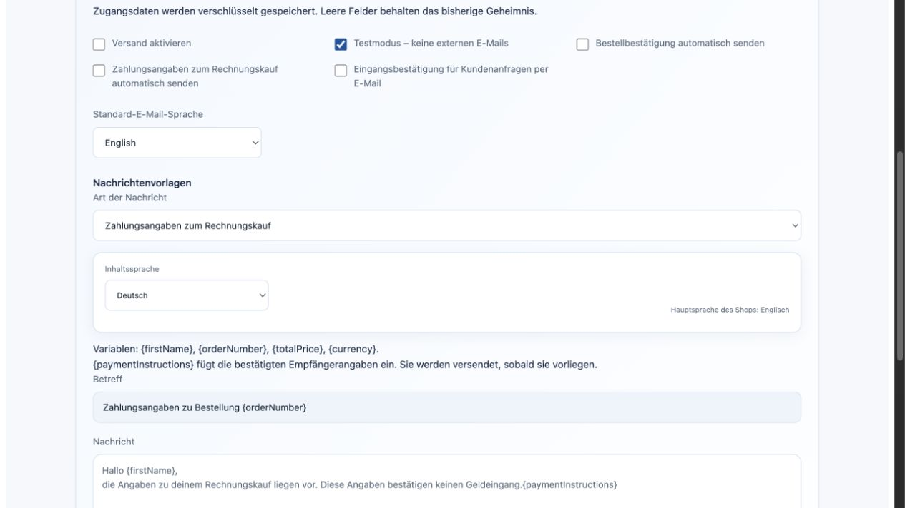

# Invoice checkout and recipient details

Shopware Payments contract **1.5.0** adds the original deferred invoice flow to
the private Rust provider. The customer enters date of birth and telephone number
inside the short-lived private payment form. The provider order is created only
after submission, using the complete invoice source and the original processing
instruction. No PayPal approval link or second capture request is invented.

## What the customer sees

The form shows whether the invoice is still being checked. Recipient details can
arrive while the capture is pending. Bank name, recipient, IBAN, BIC and payment
reference then appear without declaring the payment received. The normal native
payment status remains authoritative. Final recipient details also remain
available in the order completion checkout, outside the private frame.

The recipient display supports English, German, French and Spanish and was
inspected at desktop and 390-pixel checkout width using marked example data.
Simulation uses a separate explicit approval/cancellation choice and synthetic
recipient details. Its display says **Do not transfer money**.

## Ownership and integration

`GET /store-api/payments/{id}/instructions` requires the original checkout
capability. `GET /api/payments/{id}/instructions` and MCP
`merchant.payment.instructions` require current `payments.read`, `orders.read`
and `customers.pii`. MCP `checkout.payment.instructions` uses the same customer
capability. Unknown methods return an unsupported result. Payment-only transaction
inspection continues to omit bank, payer and customer fields.

The optional `instructions` method capability is frozen in the native payment
attempt alongside account, invoice, environment and adapter version. The Core
validates a typed recipient projection, bank checksum and reference bounds.
Validated instructions are cached immutably in the existing payment context.
They do not change the native monetary state. The existing payment worker, signed reconciliation, history and
Flow events retain ownership of actual financial transitions.

## Invoices, email and flows

The first validated recipient receipt emits `payment.instructions.available` in
that same native transaction. Reconciliation and restarts cannot emit a second
notification. A pending capture remains unpaid even when these details exist.

Native invoice generation freezes these details in the existing immutable receipt
snapshot and prints a localized payment footer. Issuing an invoice before the
provider supplies its recipient details returns a conflict before allocating an
invoice number. Delivery notes and cancellation receipts never request payment.
Document access keeps its existing private document and customer-data permissions.

Email Delivery **1.3.0** offers a separate **Invoice payment details** template
and an opt-in automatic notification. Its `{paymentInstructions}` variable uses
the native amount, currency scale, recipient and reference. English, German,
French and Spanish templates are editable through the same content-language
picker as order confirmations; HTML substitutions are escaped. Simulation details
explicitly prohibit money transfer. Queue payloads remain encrypted.

The added app capability `payments.instructions.read` requires current
`payments.read`, `orders.read` and `customers.pii` at package approval. Event
projection discloses the recipient only with that exact app capability plus
`customers.pii`. Existing Email 1.2.0 remains approved without receiving this new
capability; upgrading to 1.3.0 requires review of its new permissions.

The graphical Flow Builder can target `Email Delivery → send_payment_instructions`
on the same event. The existing HTTP/MCP action gateway requires the same current
compound rights. Stored Flow job definitions omit bank instructions; execution
reloads the original order's evidence after checking the actor's current rights
and the installed app's explicit permissions. Choose either automatic notification
or a Flow for the same business message to avoid intentional duplicate sends.

### Local template view

These screenshots show the actual Email Delivery component with synthetic
settings, using the Studio styles. They are a component visual check, not a
hosted provider-account test. The 390px view has no horizontal form overflow.

[Mobile template view](assets/payment-invoice-20261103/email-templates-mobile.png).

## Recovery and cancellation

A stable private handle is created before the provider order exists. The private
service links the eventual provider order without changing that native handle.
Date of birth and telephone number remain transient; a committed payload digest
prevents a lost response from being retried with changed input. The same request
key recovers the original submission. A verified order webhook can also recover
a lost response after a fresh account-bound invoice read, without a second create.

The existing durable notification queue polls unresolved invoices across restarts.
It does not send a capture command. Accepted recipient details are immutable.
Before submission, cancellation prevents any provider create. After submission,
unconfirmed outcomes retain their native payment and stock reservation until the
provider confirms settlement or a terminal outcome without funds. Refunds use
actual owned captures and the same exact native refund budget.

## Version and acceptance

The private service needs migration **003** before its strict runtime starts.
It adds four columns and one fixed index to the existing shared attempt table.
No merchant, app or transaction receives a separate table. The restricted runtime
keeps its existing grants; a migration owner applies the schema. Preserve older
adapter versions for historical payments when adding 1.5.0 to service configuration.

On 3 November 2026, actual public Core and private Rust services with isolated
PostgreSQL and local provider HTTP passed deferred creation, immutable recipient
instructions during capture review, current HTTP/MCP rights, foreign-cart/tenant
denial, same-key response recovery, verified webhook recovery, restart, verified
cancellation and exact partial/full refunds without a capture POST. The same actual-service test additionally accepts pending-invoice conflicts,
immutable PDF snapshots, exactly one encrypted automatic mail and a separate
Flow-triggered mail using reloaded recipient evidence. Targeted tests cover app
projection, HTML escaping, four message languages and exact currency precision.
The simulation
matrix exercises all 17 methods using contract 1.5.0 with zero provider requests.

This release remains a feature branch pending hosted schema migration and rollout.
External account tests were deferred by the owner. Customer vault/recurring flows
and remaining express/wallet configuration remain separate items in the original feature-parity delivery. The public
[Storyfront card simulation acceptance](shopware-payments-acceptance.md) retains
its original observed release and scope.
