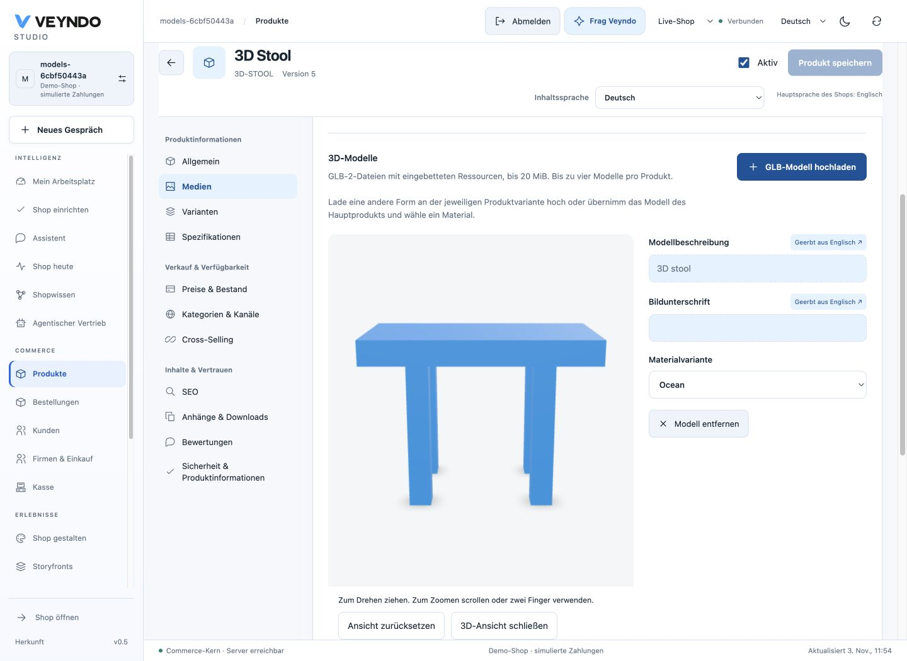

# 3D products and variants

Products can combine their image gallery with up to four interactive 3D models.
The standard storefront uses the same native product and SKU data as Studio,
checkout, HTTP and MCP. Models are loaded when the shopper opens the 3D view.

## Add a model

1. Open **Products → your product → Media** and find **3D models**.
2. Choose **Upload GLB model**. Use a self-contained GLB 2 file up to 20 MiB.
   Geometry, textures and materials belong inside that file.
3. Open **View in 3D** to rotate and zoom the actual model. Reset returns the
   camera to its initial framing. Failed loads offer a retry.
4. Edit **Model description** and **Caption** in the selected content language.
   Missing translations inherit the configured shop main language.
5. Save the product draft through its normal save action. The product revision,
   history, permissions and stock-safe content save remain authoritative.

The merchant preview uses authenticated `GET /api/merchant/assets/{id}` with
`catalog.read`. It can show an unfinished or inactive product without activating
it. Studio reads its bytes through the explicit authenticated browser transport
and gives the viewer a temporary blob URL, released when the preview closes or
changes. No credential is placed in a model URL. Upload and publishing use the existing asset endpoints and `catalog.write`.
The standard public asset route still requires published attachment bytes and
current product/channel admission.



## Bind the right model to a variant

For a different shape, open the relevant product variant and upload its own GLB.
For a different material, the same geometry can be reused:

1. Upload a GLB containing `KHR_materials_variants` to the parent product.
2. Open the SKU and choose **Use models from parent product**.
3. Open its 3D preview, then select an actual **Material variant** from that file.
4. Save the SKU. For example, one SKU can select `Oak` and another `Ocean`.

The saved binding identifies the exact native asset and material name. The server
checks that the asset belongs to the product or its actual parent and that the
material exists inside the GLB. It rejects cross-shop URLs, foreign assets and
invented material names. Parent reuse is an explicit copy into the SKU's media
assignment; changing the parent later does not silently rewrite every SKU.

Selecting another SKU in the storefront refreshes the authoritative product,
price, stock and media. If the shopper is already viewing 3D, the next SKU opens
its own model/material directly. Image thumbnails, product cards, POS, cart,
order confirmation and account history continue using image assets rather than
attempting to render a GLB as an image.

## Shared media contract

```json
{
  "id": "owned-asset-id",
  "type": "model",
  "url": "/store-api/assets/owned-asset-id?shop=your-shop",
  "view": "Chair in oak",
  "modelVariant": "Oak",
  "alt": {"en": "Oak chair", "de": null},
  "caption": {"en": "Explore the chair from every side"}
}
```

Existing media without `type` remain images. Public product serialization resolves
translated descriptions/captions using the native language chain. Admin edits keep
the original nullable maps. The existing product update capability and outbox event
also cover model changes; there is no separate model catalogue or database table.
External frontends can consume the typed entries from the existing Store API.
The private Storyfront renderer needs to consume these typed entries to display
3D itself; this feature does not replace its editor or renderer.

## Private design and selected publication

Sandbox clones retain immutable model bytes through existing product assets.
Their URLs are rebound to the sandbox shop. Publish the changed product and its
new asset together through the existing release selection. A product-only release
fails if its required asset has not been published. Existing material assignments
participate in product history and revision checks. Restore does not rewind stock.

## Format, performance and security

- GLB 2, maximum 20 MiB per file, four models within the normal 20-item gallery.
  Other uploads retain their existing 8 MiB limit.
- Rust checks header/version, exact chunk lengths, JSON structure, buffer lengths,
  geometry bounds, resource references and material names. External resource URIs,
  Draco, meshopt and KTX2/Basis decoder extensions require conversion before upload.
- The bundled viewer is `@google/model-viewer` 4.4.0. Its engine is a separate lazy
  chunk, served by Veyndo. An unused meshopt decoder is excluded because native
  admission already rejects that format. No new CDN or CSP eval permission is added.
- Mouse, touch and keyboard controls, localized instructions, retry, reset and
  responsive layout share the same component in Studio and the storefront.
- AR, USDZ, OBJ/FBX conversion and automatic generation of 3D geometry are separate
  features. Existing AI image generation remains an image workflow.

## Verification

`product_models` is registered in the daily native HTTP suite. Its isolated shops
exercise real upload/download, inactive private preview, malformed/remote-resource
rejection, material and geometry SKUs, tenant/channel isolation, stale saves and
selected sandbox publication. Two Rust format tests and focused frontend tests
cover the parser, current rights, parent reuse and safe image-only consumers.
The original synthetic stool fixtures are authored locally in
`scripts/testing/model_fixture.py`; they contain no external resources.
