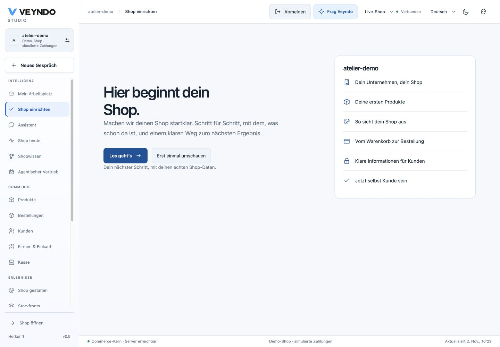
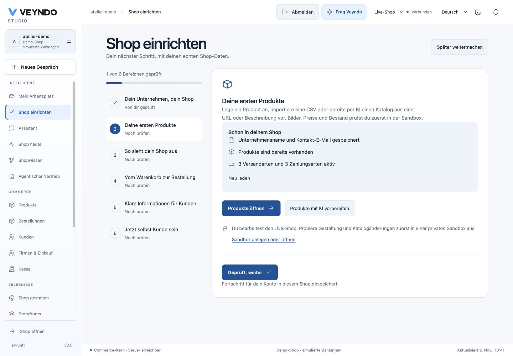
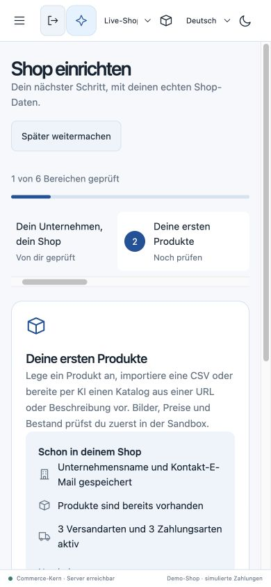

# Set up your shop, one reviewed step at a time

Open **Set up your shop** near the top of the Studio sidebar. The optional guide
connects six setup areas to the existing shop tools. You can pause, continue your
ordinary work and return to the same step later.

The first visit to an unconfigured personal workspace in a shop without orders
also offers a welcome. The guide and its controls support English, German, French
and Spanish. Its source and local acceptance are recorded below; public deployment
of this addition has not been observed.

## Start with the basics

Start the guide from the welcome or sidebar. Enter the company name, contact email
and address directly in the first step, then save with the native company form.
These are real shop settings. Review them before moving on.

Each area shows available native shop information and a route to the tool that
owns the work. Review the result yourself, then explicitly mark that area reviewed.
Existing settings or a product count do not silently complete a step.

| Area | Work to review | Where it leads |
| --- | --- | --- |
| Basics | Company name, contact email and address | Inline native company form and existing settings |
| Products | Product information, images, prices and catalogue preparation | Existing product catalogue and editors |
| Design | The shop appearance and its private changes | Existing Shop design editor |
| Checkout | Payment, delivery and checkout configuration | Existing settings and sandbox tools |
| Legal | The shop's legal information and pages | Existing legal settings and views |
| Test | A deliberate test and inspection of the resulting order | Existing sandbox and order views |

Opening a tool retains the normal permissions, saves and publication controls.
Design changes follow the [private workspace and selected release path](personal-workspace-and-shop-design.md#design-the-standard-shop).
For catalogue intake, follow the [merchant catalogue guide](merchant-catalogue-setup.md).
For a first simulated purchase and a selected release, follow the [local tour](first-tour.md).

## Get help with the current step

Use the guide's AI action to open the existing merchant assistant with the current
setup area as context. You can ask for an explanation or a proposal and inspect
what it prepares. The assistant keeps its existing model configuration, authority
and approval path. The guide does not configure a provider or publish changes on
your behalf. [Model configuration and connections](connectors.md).

## Pause and return

Pause the guide when you want to work elsewhere. **Set up your shop** reopens it
at the saved area. During active setup, a return banner also links back from other
live shop views. The banner is hidden inside a sandbox.

Your progress belongs to your personal account and the selected live shop. Reloading
or reopening retains saved progress. Another person has their own progress. Concurrent
updates use the existing workspace revision check, so a stale save produces a conflict
instead of overwriting a newer version. If another tab changes setup progress,
reload the guide before continuing. Its reviewed areas remain intact; unrelated
layout changes from another tab are retained when saving your progress.

Complete the guide after reviewing all six areas. Completion records your review;
it does not certify legal compliance, a real payment provider or a successful purchase.
Test those through the existing configuration and commerce paths and inspect the
actual result. The guide remains available through the sidebar.

## Source owners and local acceptance

The guide adds optional progress to the existing revisioned personal workspace.
It creates no additional table, API operation or onboarding execution service.
Existing workspace row security, revisions and history apply.

| Responsibility | Existing or feature owner |
| --- | --- |
| Welcome, guide, progress and return banner | `frontend/src/admin/setup/` |
| Inline company form | `SetupBasics.tsx`, reusing `settings/useSettingsDraft`, `CompanyField` and `SettingsSaveBar` |
| Saved progress validation | `src/studio/personal/model.rs` |
| Bounded current setup context for AI | `src/agent_runs/context.rs` |
| Layout, goals and personal identity | Existing personal workspace owner; setup saves preserve these fields |
| Company, products, design, orders and publication | Existing native owners reached from the guide |

Local checks on **2 November 2026** passed 17 targeted UI tests: twelve setup tests
and five workspace/navigation tests, including current rights and visibility cases.
Four native Rust tests cover the personal setup model and bounded assistant context.
Real HTTP/PostgreSQL checks cover saving, reopening, pausing, completing, history,
MCP readback, stale revision rejection (409), foreign shop rejection (403) and invalid
input rejection (400). The targeted UI cases also exercise two independent
controllers: a stale second tab preserves the first tab's reviewed Basics step
and recovers by reloading. A fresh unrelated layout change survives a setup save.
The Products AI action invokes the existing merchant assistant once with the
current shop and setup context.

An actual local browser journey saved the company through the native form, explicitly
advanced a review step, paused and reopened the same Products step. Two actual
browser tabs rejected a stale progress edit and recovered the newer Design step
after reload. At 390px, advancing Products to Design automatically revealed its
rail item, with no document overflow. Guide completion and a fresh review were
exercised using synthetic progress. Desktop and narrow
screen captures above show the local implementation. These checks do not establish
public deployment, a new AI provider acceptance or a completed purchase.
