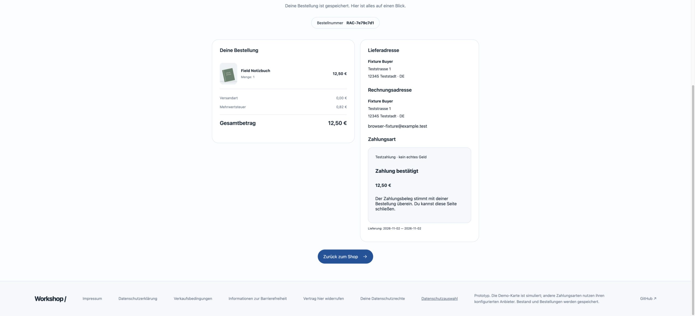
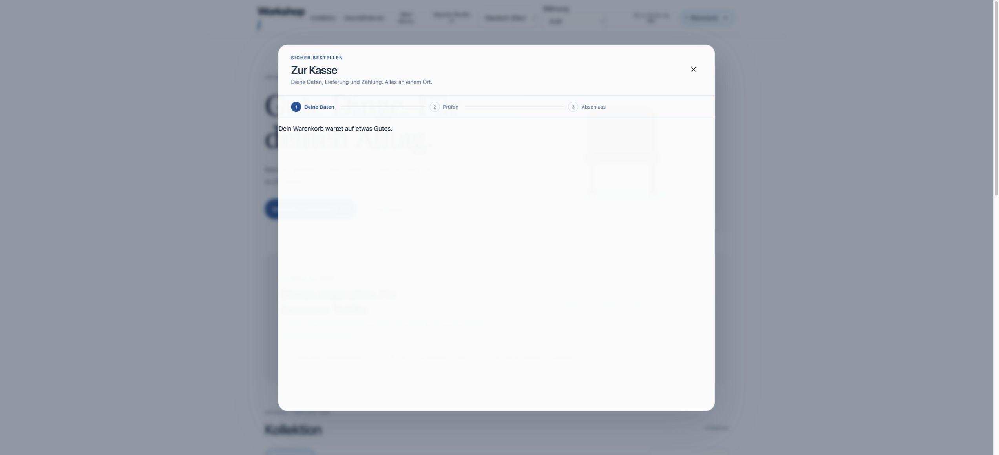
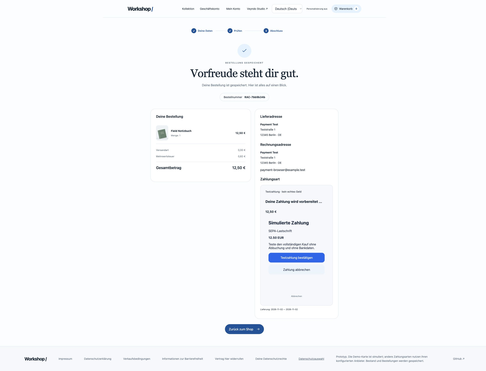
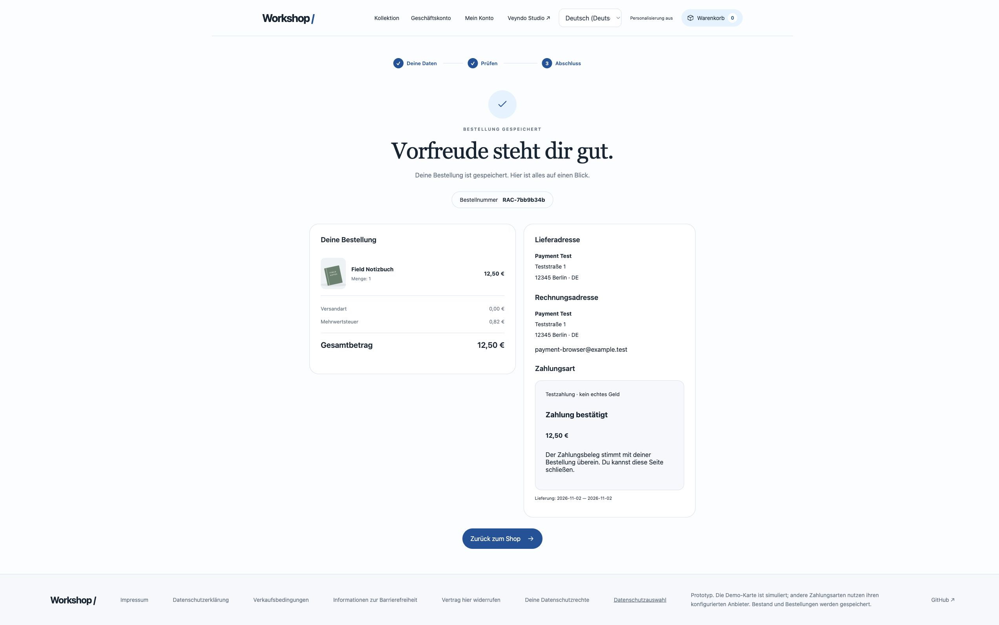
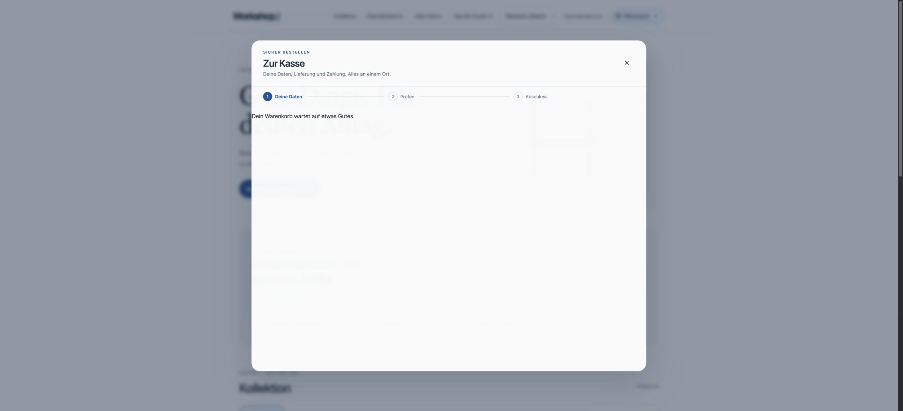
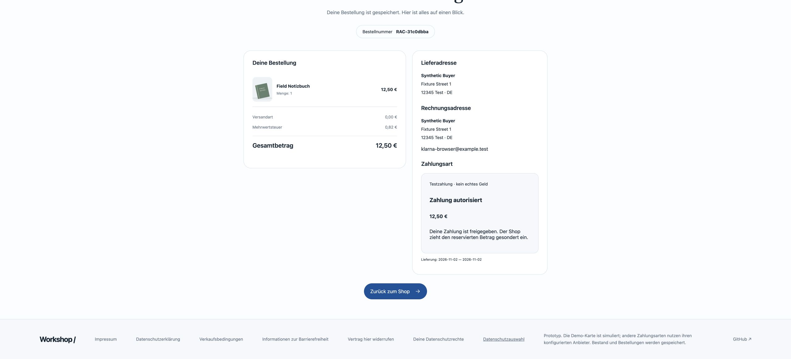
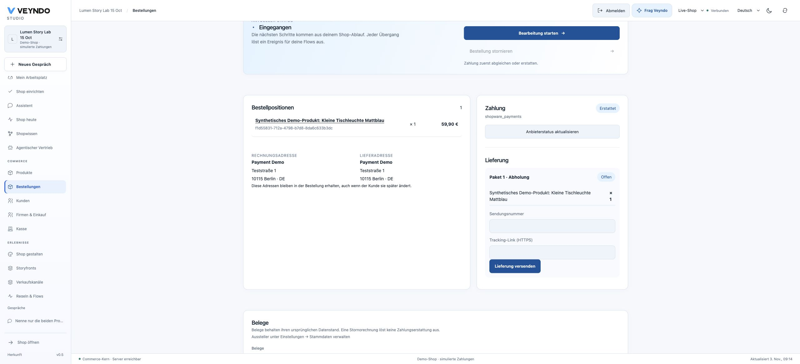

# Shopware Payments: integration and test acceptance

Updated 3 November 2026. The private Rust connector implements the provider path;
the public Core owns the order and payment ledger. The public catalogue now ships
the versioned 1.3.0 contract for all 17 methods. Install or upgrade it through the
existing app lifecycle, connect the configured account and enable its methods.
Installing the contract does not provision the private service or activate methods. Use [the provider contract](payment-provider-api.md) for deployment.

## Capture management, 3 November 2026

Contract 1.3.0 adds native partial/multiple capture, exact per-capture refunds,
confirmed remainder void and pending/lost-response recovery. The order and
payment views share the balance/allocation controls; shop/channel settings choose
immediate capture or authorization. [Workflow and acceptance boundary](payment-capture-management.md).
These additions have local native-service acceptance. They are not yet a new
public provider acceptance. The owner deferred external account tests until later.

## What can be tested now

The existing private `tests/local_stack.py` starts the actual private Rust service,
public Rust Core and disposable PostgreSQL against a synthetic PayPal-shaped HTTP
server. This exercises financial state changes through the real services. The PSP
responses and merchant are synthetic; no external payment network is contacted.

| Journey | Current acceptance |
| --- | --- |
| Merchant onboarding, channel account and disconnect | Real services with simulated referral/account callbacks; disconnect survives a delayed callback |
| Purchase and immediate capture | Real Core/private-service order and signed callback, exact receipt and once-only capture |
| Authorization and void | Private provider lifecycle, including pending outcome rejection and repeated confirmed void |
| Partial, pending and full refund | Real native ledger; pending refund is polled by its original ID rather than submitted again |
| Currency | EUR, USD and zero-decimal JPY purchases and refunds; malformed precision and unsupported currencies denied before PSP traffic |
| Recovery | Private service restart and saved request replay; original EUR adapter 1.0.0 remains usable |
| Tenant, receipt and browser-session isolation | Foreign tenant/account/payee/amount/parent rejected; scoped token and nonce retained |
| SEPA form confirmation | Private endpoint validates the IBAN and explicit mandate consent before the original nested provider request |
| Native browser purchase | Actual Chrome desktop and 390px viewport: private SEPA form, confirmed payment, return and empty cart; simulated PSP only |
| Hosted simulation contract | All 17 methods with 12 concurrent callers, native cancellation, exact partial/full refunds and durable replay across restart; zero PSP traffic |
| Restricted service runtime | Separate migration bootstrap and non-owner runtime; owner runtime and runtime migration rejected |
| Shipped simulated form | Actual scoped session and confirmation endpoint, German shop language over English browser default, readiness nonce and no bank inputs; native Chrome SEPA purchase, return and empty cart also pass |
| Original Storyfront server integration | Real original checkout/completion handlers with native transfer, private simulated capture, exact proof rejection and complete refund; browser framing is separate |
| Public original Storyfront card checkout | Order RAC-ef438264: actual nested native/provider frames, EUR 59.90 captured, return, original empty bag after reload, EUR 0.01 + EUR 59.89 refunds and provider reconciliation |

The connector's 1.1.0 package widens PayPal/card currency declarations to its supported
currency list. It preserves the exact currency scale in new invoices and replay
fingerprints. PayPal's HUF and TWD whole-unit rule is checked without rounding an
invoice. Unsupported three-decimal currencies stay unavailable. Method declarations
still require account capabilities and method-specific country/amount admission.

## Embedded form loading

The native checkout waits visibly for the provider form. Providers can return
`readySignal: true` in their scoped session and send `veyndo.payment.ready` with the
bound nonce after rendering controls. Exact frame window, origin and nonce are
required. A readiness message never records payment or queues capture.

A form that does not respond within 20 seconds shows a translated recovery action.
Reloading requests a new presentation session for the same attempt; it does not
place another order or create another payment. Older providers retain their frame
load behavior. Session request failures also offer recovery. Explicit loopback HTTP
UI origins are permitted only for `contract-fixture` and must still appear in the
operator's approved origins; Sandbox and Live continue to require HTTPS.

## Observed native browser journey

Two local Chrome purchases used the actual private SEPA form: desktop order
`RAC-7e79c7d1` and order `RAC-15319777` at a 390 × 844 viewport. The browser
entered the synthetic account holder/IBAN, confirmed the test mandate and displayed
**Zahlung bestätigt** for EUR 12.50. Both returned to the collection and opened an
empty bag. The same two orders then passed a one-cent native merchant refund,
replay of that refund key and the exact EUR 12.49 remaining refund.

The initial iframe document was held by the browser controller after HTTP 200.
The visible timeout and **Zahlungsmaske erneut laden** recovered the form on both
viewports, without another order. These captures show local simulated provider
acceptance, not an external bank transaction or Storyfront acceptance.

[Mobile private SEPA form](assets/payments-20261102/mobile-provider-form.jpg) ·
[Mobile form recovery](assets/payments-20261102/mobile-payment-recovery.jpg).

## Hosted simulation browser acceptance, version 1.2.0

Local Chrome order `RAC-7bb9b34b` used the shared simulated SEPA form in German.
A second card order, `RAC-f8831534`, passed at 390 × 844 pixels. Both show
confirmed payment, return to the shop and an empty bag. The merchant API then
refunded one cent, replayed that same refund key and refunded the exact EUR 12.49
remainder for each order. No external money was involved.
After confirming the explicit test decision, the native checkout displayed
**Zahlung bestätigt** for EUR 12.50. Returning to the collection and opening the
bag showed zero items. The browser controller initially held the iframe document;
the existing form-reload action recovered the same order without a second purchase.
This accepts the local standard storefront path. Public hosting and the original
Storyfront iframe remain separate acceptance steps.

[Mobile card form](assets/payments-20261102/mobile-card-simulation.png) ·
[Mobile payment confirmation](assets/payments-20261102/mobile-payment-confirmed.png) ·
[Mobile empty bag](assets/payments-20261102/mobile-returned-empty-cart.png).

## Klarna browser authorization and capture, 2 November 2026

Local Chrome order **RAC-31c0dbba** used the actual shared private payment form
for Klarna and EUR 12.50. The simulation stored the explicit shopper decision;
the native receipt showed **Zahlung autorisiert** and explained that the merchant
collects the reserved amount separately. The merchant's native capture command
then changed the ledger to `captured`. Replaying the same capture key returned
the original job. After reload, the receipt showed **Zahlung bestätigt**.

The browser returned to the collection and opened the empty native bag. A
one-cent refund, replay of its key and the exact EUR 12.49 remaining refund
completed against that same order. The final native state is `refunded`.
The browser controller initially held the provider document; the visible
presentation reload recovered this same order without another purchase.

[Confirmed capture](assets/payments-20261102/klarna-captured.png) ·
[Returned empty native bag](assets/payments-20261102/klarna-returned-empty-cart.png) ·
[Recorded result](evidence/klarna-browser-2026-11-02.json).

This is the local standard-storefront simulation with real Rust services and
PostgreSQL. It does not establish public hosting, an actual Klarna provider
account, bank approval or the nested original Storyfront browser journey.

## Original Storyfront server integration, 2 November 2026

The original Storyfront handler at pin `5d5f0e743b083a4154044f1ab26b778f1916dad2`
was called directly with an isolated fixture scope. It read a manifest generated
from the real Core catalogue, mapped its product to the canonical SKU and issued
the native single-use checkout handoff in German. The actual Core and private
Rust payment service created order **RAC-5bdd03cf**, captured the simulated
**EUR 12.50** SEPA payment and admitted the signed notification.

The unchanged original completion handler then verified that exact native order.
It accepted a repeated valid proof and rejected a changed quantity and a different
order ID. Native refunds accepted one cent, replayed that request without another
refund and completed the exact EUR 12.49 remainder.

This is an integration check of the original server handler and actual Rust
services. It does not replace the original browser's bag, nested iframe, return
or public-hosting acceptance. On 3 November the dedicated public service and restricted database access were
provisioned, and the synthetic merchant onboarding completed. The original nested browser purchase then passed on 3 November as recorded below.
No PSP was contacted.

[Machine-readable result](evidence/storyfront-payment-service-2026-11-02.json).

## Comparison with Shopware

The [official Shopware Payments guide](https://docs.shopware.com/en/shopware-6-en/shopware-services/shopware-payments)
describes account/channel setup, immediate/manual collection, payment methods,
transaction management, Flow actions, express checkout, Pay Later placement,
vaulting and wallet configuration. Matching the native ledger backbone is not a
claim of complete feature parity.

Completed hosted steps and remaining provider work are tracked explicitly:

- [x] Deploy the private provider service with its own restricted database access,
  HTTPS UI origin and native Core connection. Hosted simulation is online. Provider
  Sandbox/Live additionally require approved partner configuration and callbacks.
- [ ] Connect an authorized Shopware Payments test account and complete browser
  payment, capture, void, cancellation and refunds against that account.
- [ ] Accept each enabled card/wallet/redirect method, including 3DS outcomes,
  country/currency eligibility and uncertain responses on that actual service.
- [ ] Complete original express/payment messaging controls through the existing
  versioned configuration. Native manual collection already has the separately
  recorded local Klarna browser acceptance above.
- [x] Implement externally initiated completed-refund reconciliation, with signed
  capture-link notification, native job binding and duplicate/changed-receipt
  rejection. Both actual Rust services pass against a local HTTP provider fixture;
  external PSP acceptance still requires the authorized account below.
  [Native regression evidence](evidence/payment-refund-reconciliation-2026-11-03.md).
- [ ] Complete vault/recurring lifecycle, multi-capture, dispute reconciliation,
  reporting/fees and shipment tracking.
- [x] Accept the public original Storyfront embedded card simulation through the
  actual hosted private provider, return, empty original cart after reload and
  complete native merchant refund on 3 November.

Shopware supplies a test account in its own integration. Access to the original
source does not supply the approved partner credentials for a standalone Veyndo
service. Apple Pay is not supported in that Shopware test account; its domain
registration uses an active production account. Real charges are outside this
acceptance: the selected payment mode remains simulated.

The [PayPal currency reference](https://developer.paypal.com/api/codes/currency/)
explains the whole-unit currencies. Additional merchant eligibility and currency
receiving preferences are applied by the provider, not inferred from a manifest.

## Repeating the local test

Build the public Core and private connector. Version 1.2.0 also provides
`SWP_SIMULATION_ONLY=true` for the hosted simulation cases, including execution of
the shipped checkout document with Node 22. Use a separate throwaway database for
each invocation.

For the original-shaped provider regression, in the private repository run
`COMMERCE_ROOT=/absolute/path/to/veyndo python3 tests/local_stack.py`. Supply a
throwaway `DATABASE_URL` or the test container and `DB_PORT`. Do not point the suite
at a merchant database. It removes its own automatically created database on exit.
`SWP_BROWSER_ACCEPTANCE=true` retains the isolated test processes for a browser
journey and writes only the local shop/provider URLs to `.run/browser-acceptance.json`.
Stopping it cleans up the isolated database.

See [checkout](checkout.md), [payment provider API](payment-provider-api.md),
[testing](testing.md) and [the current product status](status.md).

## Hosted deployment, 3 November 2026

The private Rust service runs in simulation with schema versions 1 and 2. Its
dedicated runtime login has neither ownership, superuser, role administration,
database creation, role inheritance nor RLS bypass. Temporary maintenance access
was removed after migration and verification. Core resolves the versioned service
through the existing payment and app contracts; no provider source is shipped in
the public Core.

Synthetic merchant onboarding succeeded. Enabling the expanded method catalogue
exposed the ordinary 64 KiB settings request limit. Only shop and channel settings
now allow 1 MiB, with a structured JSON rejection above that limit. A targeted real
HTTP test covers the larger catalogue, the unchanged ordinary route limit and the
oversized settings error. The completed public original Storyfront card journey is recorded below.

## Public original Storyfront purchase and refund, 3 November 2026

The public Lumen Storyfront created **RAC-ef438264** for one synthetic Mattblau
lamp, **EUR 59.90**, with pickup, zero shipping and EUR 9.56 included tax. The
German order confirmation retained the German product name. The actual native
checkout appeared inside the original Storyfront, and the private payment
service's card simulation appeared in a second nested frame. Explicit test
confirmation changed the native payment to **captured**.

The normal browser-controlled tab initially held a frame document response. The
same public journey completed through the actual native Chrome interface without
changing authentication, frame security or application source. The user did not
perform any manual testing. The provider form loaded normally in that journey.

Returning through **Zurück zum Shop** closed the embedded checkout and updated the
original Storyfront bag to zero items, with its completion message. Reloading the
original Experience and opening the bag again still showed zero items.

Native Studio requested a **EUR 0.01** partial refund, observed **partially
refunded**, then requested the exact **EUR 59.89** remainder. The same order showed
**refunded**. Refreshing the provider status retained that confirmed final state.
The history also records the native `order.placed` and `payment.captured` Flows.

The private runtime was observed at documentation revision
`cdea3552fc39ccaf4dee1e7952dfa5ba5c8a8a47`, retaining the implementation first
hosted at `9511263faa8ababb01fb87f836ddd9a68127686e`. Public Core ran
`1f8c2a45b55dc1bcc00944e36a352299b06c517e`, build `auspicious-key-6715`.
Only the shop/channel settings routes receive the 1 MiB allowance; the full
catalogue now saves successfully and ordinary request limits remain unchanged.

[Saved method configuration](assets/payments-20261103/payment-methods-saved.jpg) ·
[Structured observation](evidence/public-storyfront-payments-2026-11-03.json).

This records public card simulation through the original Storyfront. The 17-method
contract, local concurrent coverage and local SEPA/Klarna journeys retain their
separate scope. Real PSP Sandbox/Live approval and complete original feature
parity remain in the comparison above. No bank or card network was charged.
