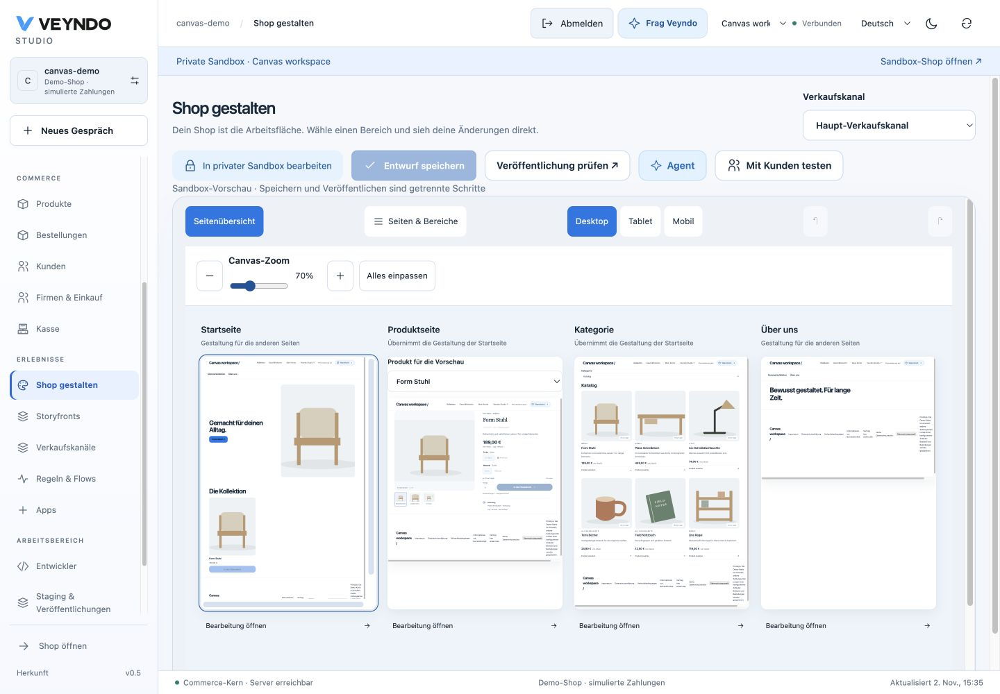
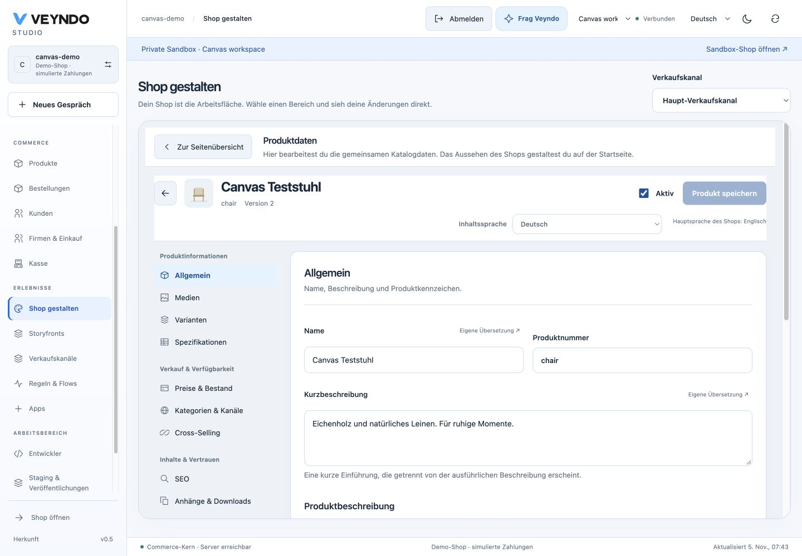
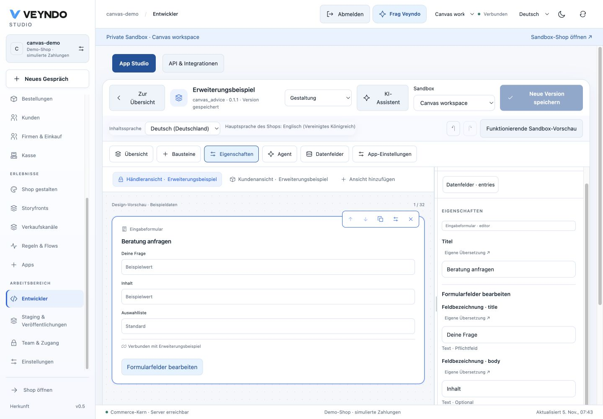
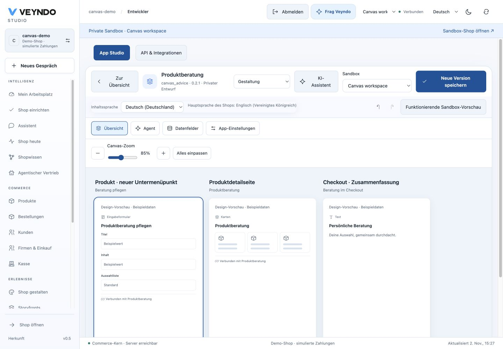
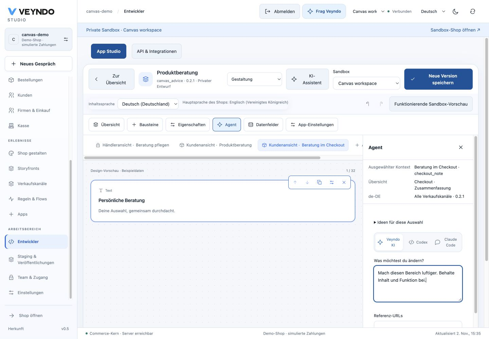

# A visual workspace for shops and apps

The useful Canvas idea is a shared overview of real pages, followed by direct work
on one selected page or element. The current editors share the overview and contextual tools
described below while retaining their native definitions and publication owners.

## Working now: image captions in the existing editors

**Products → Media**, **Shop design → select an image or hero → Edit**, and
**App Studio → Design → select an image** expose an **Image caption** field.
Choose an enabled content language in the existing editor language selector.
Missing/null translations inherit the shop's main language; an explicitly empty
caption stays empty. Captions appear below the image. Accessibility alternative
text remains separate. Rich document images preserve captions in their existing
`title` attribute and display them in Preview and the storefront.

**Suggest with AI** uses the shared native `merchant.media.caption` operation,
current `assistant.use` permission and central inference configuration. Review or
edit the suggestion and choose **Use in draft**, then save through the native
editor. Generation itself saves and publishes nothing. The operation is also
available through the ordinary MCP registry and generated input contracts.

Owned product assets and bundled public fashion images provide decoded, bounded
image evidence. Public HTTPS images use the existing DNS-pinned, public-only fetch
policy with no redirects. Credentials and private-network destinations are denied.
Images are reduced to a PNG thumbnail before inference. When pixel evidence is
unavailable, the review explicitly says that the suggestion uses current content.
An App Studio image has no selected app-record image in the design inspector, so
its caption suggestion uses the app/image description rather than invented pixels.

Changing image, language, current text or request scope discards a pending proposal.
Revoked UI access hides generation; native authorization still runs on every call.
Product captions remain part of the product aggregate. Page captions stay inside
the site-builder app document. App images use the existing localized `Block.text`.
No new database table, runtime, executable markup or publication mechanism is added.

## One overview for shops and apps

Shop design and App Studio now use the same zoomable scene board. Drag its
background to pan, use the zoom control or press `+`, `-` and `0` while the board
has keyboard focus. **Fit all** fits the current group. At most four scenes are
mounted together; additional pages are reached with the view arrows. A large
catalogue is never loaded just to fill the overview.

### Shape the shop

1. Open **Shop design** and choose the sale channel. The board shows its real home,
   a selectable product, a category listing and its content pages.
2. Choose **Design page** on a page. Click a section to reveal its properties.
   Collapse **Properties** and **Pages & sections** whenever the preview needs room.
3. Drag an element to the insertion line. Selected sections expose move, duplicate
   and delete controls. These edit the existing page document and undo history.
4. Return to **Page overview**, open another page and come back. The unsaved page,
   its selection and undo history stay in this workspace. A channel change warns
   before discarding unfinished work. Save each page explicitly before reloading.
5. Review the existing selected sandbox publication when ready.

Use **Design product page** or **Design category page** to edit a layout for the
selected sales channel. Choose a sample product or category to check the layout
with real shop data. Move built-in sections with the grip or the arrow controls,
add content from **Elements**, or adjust the appearance in **Properties**.
Gallery and purchase controls form one section. Category filters and the product
listing can move independently.

Save the layout in a private sandbox and choose **Review publication** when
ready. The live product pages and collection use the approved order of sections.
**Edit product data** and **Edit category data** are separate actions in the
layout editor for changing the sample record. Storyfront Experiences use their
own editor.

### Clear editing context

The native data view has a **Back to page overview** action and its own product or
category save. Page navigation, device controls, page save and page agent tools
stay in the page designer. This prevents a product change from being confused
with an unrelated page draft. Returning restores the retained page workspace;
leaving unfinished native data requires a choice to stay or discard.

The embedded product form uses its actual available width. When space is narrow,
**Product section** replaces the side navigation, keeping media, prices, variants
and every other permitted section reachable. Read-only views explain that editing
requires a private sandbox and the existing catalogue write permission still
applies. File upload controls are absent without that permission.

Both designers offer the same bounded, keyboard-accessible properties resize
handle. In Shop design, drag the left edge of the properties rail or focus its
separator and use the arrow keys. The width is a local display preference; it
does not modify or publish content. Choosing another element returns its
properties to the top. App Studio presents the selected element's editable fields
first; general app identity and placement settings remain available below.

### Shape every app placement together

An app starts in its placement overview, for example merchant product panel,
product detail and checkout summary. The placement name leads each scene so views
with the same app name remain distinguishable. Choose **Edit** to work on
that view. **Elements** opens the compact graphical palette; **Properties** opens
only when needed. Both can be closed. The app identity, section selector, private
environment and version save remain in the compact header.

Selected stack and grid elements share move, duplicate and delete actions.
Duplicated elements get a new ID; handlers and field bindings remain in the same
Manifest. Grid duplicates receive a bounded position offset. Stack drag/drop
marks the insertion boundary and uses that boundary even when the pointer ends on
the intervening canvas area. Existing keyboard controls provide an alternative
to dragging.

For a button or input choose **Edit behavior**. The existing graphical logic
editor edits its typed click/change handler. **Open Flow Builder** reaches the
existing automation editor; an app event is the link to a shop Flow. This does not
turn a button handler into a second Flow runtime. **Data fields** and **App settings**
open the existing definitions, then the section selector returns to Design without
replacing the edited Manifest. Version save, private functional preview, staging
and selected release retain their native owners.

### One contextual agent

**Agent** opens the right dock alongside the overview or selected view. The dock
shows the selected placement, element, content language, app version and scope.
App definitions apply across channels, displayed explicitly as **All sales
channels**; page proposals retain their selected sale channel and revision.

Write a request, supply up to three public HTTPS reference pages or upload up to
two PNG/JPEG/WebP screenshots/designs. Client preparation bounds decoded image
size and encodes a reduced image; native validation independently enforces format,
byte and dimension limits. Shop and app references share the public-only,
DNS-pinned fetcher. A page that cannot be captured safely is marked unavailable.
Captured HTML is partial reference evidence, never rendered or executed.

Veyndo AI uses central structured inference with image evidence. Codex/Claude Code
receive the same current Manifest, selected context, schema and bounded references
through the native task export. Invalid or stale selections are rejected before
inference. The existing `developer.task` operation exposes that context through
MCP and generated TypeScript/WIT/OpenAPI inputs. Screenshot HTTP requests have a
4 MiB limit on the two specific developer routes; ordinary MCP transport limits
remain unchanged, so large images use HTTP task export.

**Preview proposal** shows the candidate on the same board or selected scene.
**Current draft** switches back. Neither action adopts the candidate. Adoption
requires the existing explicit review and an unchanged Manifest/environment.
Late responses from another environment or changed selection are not adopted.
App generation retains the existing action authority and business contracts.

Reference status, URLs and digests are retained with the immutable development
version and return after reload. Raw image pixels and fetched HTML are not retained
in the build record. The current dock shows uploaded thumbnails while reviewing;
this is not a permanent original-design asset library.

## Reference and verification

Shopify documents the side-by-side overview, pan/zoom, fullscreen editing and
selection-aware Sidekick in [Canvas navigation](https://help.shopify.com/en/manual/online-store/themes/canvas/navigating)
and [Canvas customization](https://help.shopify.com/en/manual/online-store/themes/canvas/customizing).
These inform the workflow; the native editors and publication model remain Veyndo’s.

[Local caption acceptance](evidence/media-captions-2026-11-02.md) records the tested
source, storage, renderer and provider-fixture boundaries. See also the
[existing shop design guide](personal-workspace-and-shop-design.md),
[product media](settings-media.md) and [app workspace](app-studio-workspace.md).

[Canvas acceptance and tested boundaries](evidence/canvas-workspace-2026-11-02.md)
records the connected native and browser journeys.

## Direct product and category editing

Product and category editors load their own shared catalogue styles when opened
directly from the Canvas. Their layout does not depend on a previous visit to
Products or App Studio. Product sections remain beside the form on desktop and
use the existing compact section selector on narrow screens. The shared Canvas
wrapper owns its own spacing. Native language, revision, permission and private
save paths remain the same.

The blue action above each scene preview names its task: **Design page**,
**Edit product data** or **Edit category data**. The fixed toolbar also
lets you choose a view and open it at normal control size, independently of Canvas
zoom. Both entry points use the same native editor callback and disabled state.
